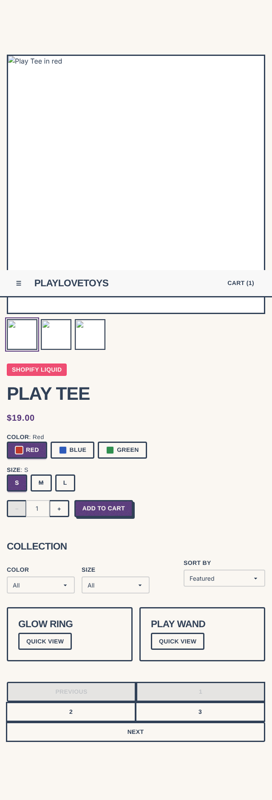
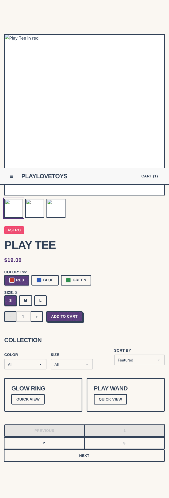
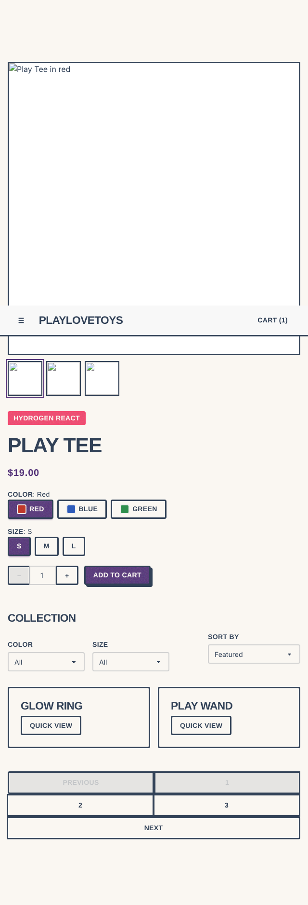
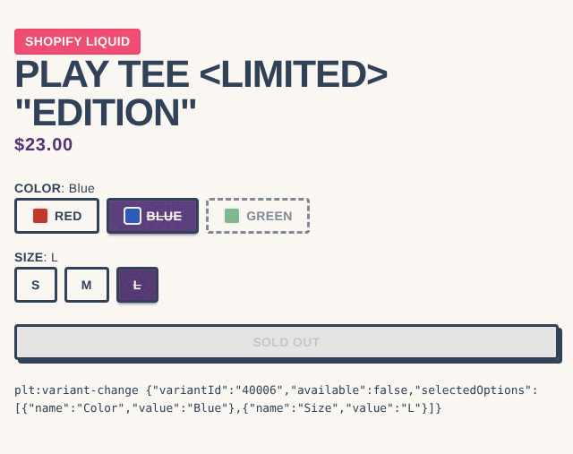
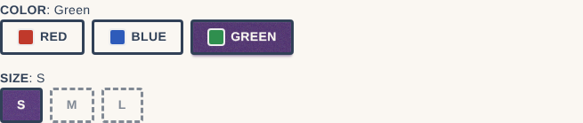
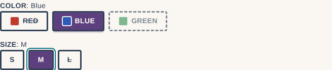
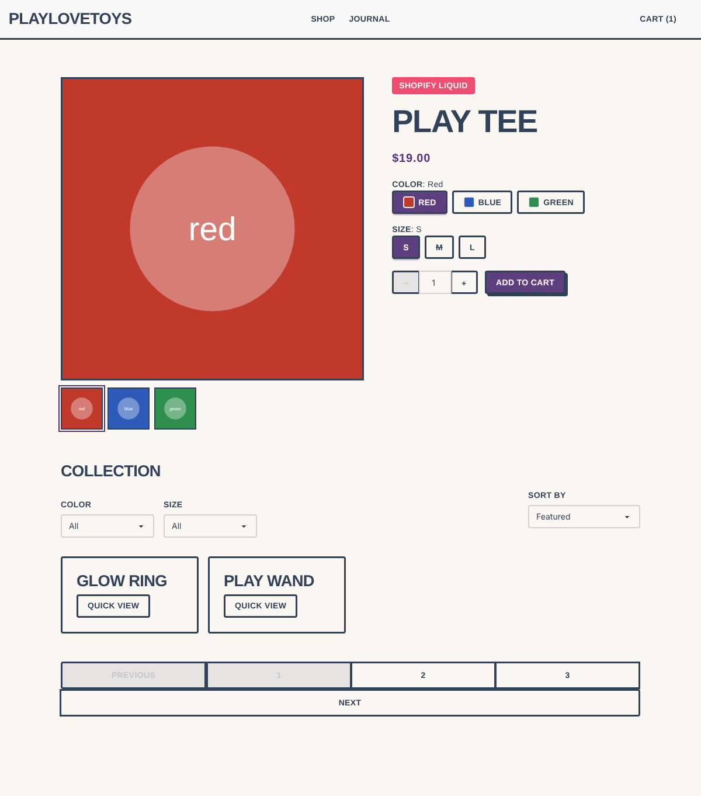
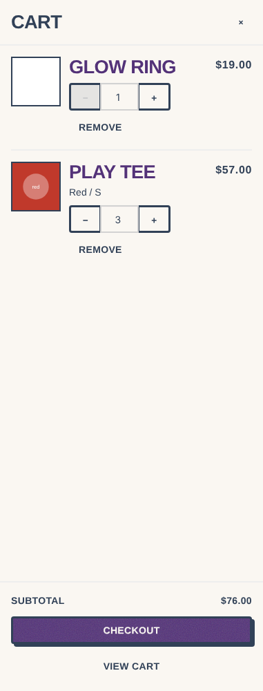
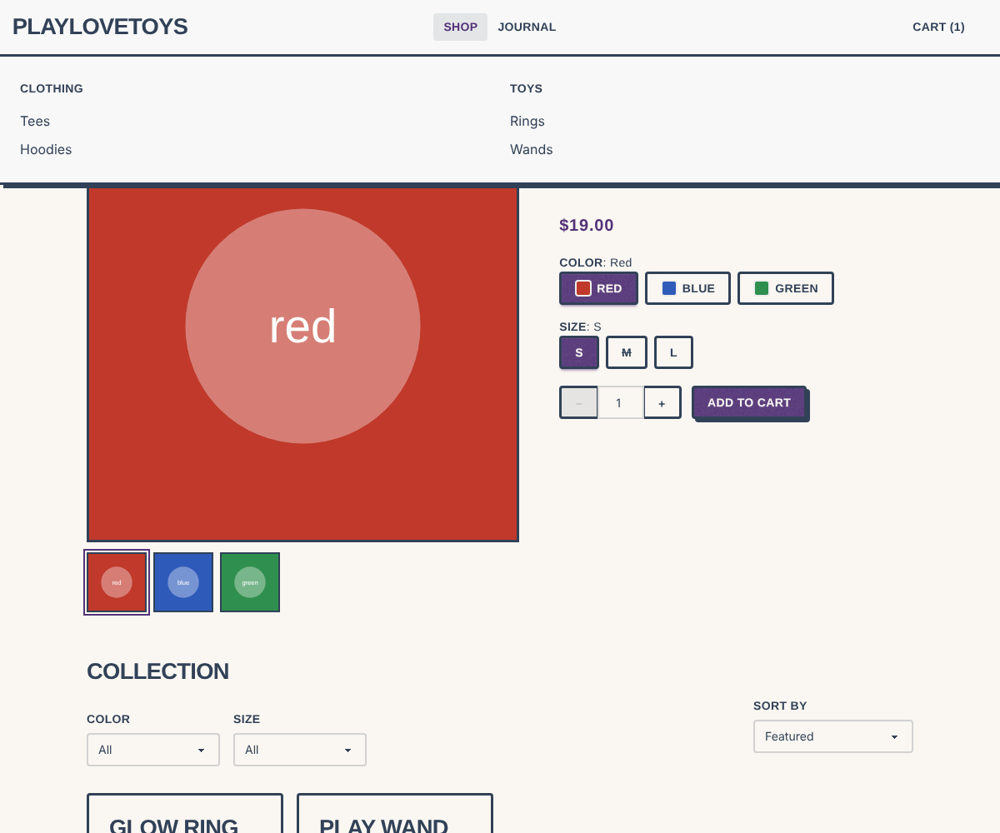
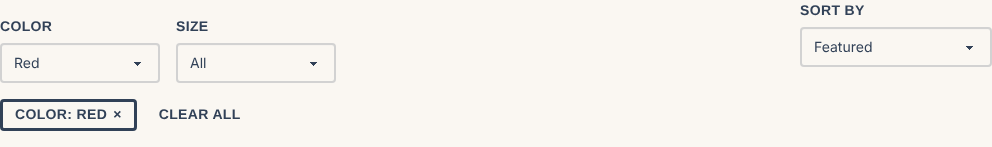

# Adopción de Lit — `<plt-variant-picker>` y grupos de componentes

Estado: **piloto mergeado (#35); grupos de componentes implementados,
pendientes de revisión humana**.
Base auditada: `plt-design-system@c8cae0b`, `plt-frontend-liquid@6755975`,
`plt-astro-storefront@eb628dd`, `tina-hydrogen-frontstore@379dfa5`.

## Resumen

- Un único Web Component Lit, `<plt-variant-picker>`, en un paquete nuevo
  `@playlovetoys/web-components`. La lógica de selección vive en un módulo puro
  (`resolve.ts`) que no depende de Lit, del DOM ni de ninguna plataforma.
- Tres adaptadores mínimos — Liquid (snippet), Astro (componente) y React
  (wrapper de ~130 líneas) — que solo normalizan datos, pasan propiedades y
  escuchan el evento DOM `plt:variant-change`. Ninguno reimplementa la selección.
- Light DOM: el componente usa las clases `d-` de daisyUI, `theme-*` y los
  tokens `--plt-*` ya existentes; no trae CSS propio salvo seis reglas de patrón
  añadidas a `patterns.css`.
- Validado en Chromium real contra tres demos construidas desde la misma
  implementación (Liquid renderizado con liquidjs, `astro build` real, React SSR
  + hidratación): 23 pruebas de navegador, 26 unitarias/SSR, axe-core sin
  violaciones, render **idéntico píxel a píxel** y árbol de accesibilidad
  idéntico en los tres frontends.
- Coste: 8,4 KB gzip el bundle autocontenido (6,3 KB son el runtime de Lit, que
  se amortiza entre componentes); 2,3 KB gzip el componente con Lit compartido.
- **Fase 2**: diez elementos en cuatro grupos (producto, carrito, colección,
  navegación), con el mismo patrón. Se validaron con 68 pruebas unitarias/SSR
  y 49 de navegador en los tres frontends: axe sin violaciones, respaldos sin
  JS, y paridad de píxeles y de árbol de accesibilidad. Todo junto pesa
  14,9 KB gzip, Lit incluido.

## Fase 2 — Grupos de componentes

Tras el piloto se pasaron a Lit cuatro grupos, con el mismo patrón: una sola
implementación, adaptadores Liquid/Astro/React mínimos y pruebas en los tres
frontends.

| Grupo | Elementos | Antes |
| --- | --- | --- |
| Ficha de producto | `<plt-variant-picker>`, `<plt-quantity-selector>`, `<plt-product-gallery>`, `<plt-quick-view>` | Galería y quick view: CE vanilla del DS. Cantidad: solo marcado, clics a cargo de cada plataforma. |
| Carrito | `<plt-cart-line>`, `<plt-cart-drawer>` | Renderers sin comportamiento (drawer de daisyUI con checkbox); controles y estado en cada plataforma. |
| Colección / listado | `<plt-filter-bar>`, `<plt-sort-select>`, `<plt-pagination>` | Formularios estáticos con botón «Apply». Al integrar el storefront se añadieron filtros de varios valores (`multiple`: checkboxes con conteo; marca y categoría de Shopify lo son) y `preserve` (parámetros que otro control posee, p. ej. el orden, viajan como campos ocultos). |
| Navegación | `<plt-navbar>` (menú móvil + megamenú) | Toggle móvil vanilla; el megamenú lo reimplementaba cada plataforma (Hydrogen: `useMegaMenu`). |

### Decisiones adicionales

1. **Dos tipos de elemento.** Los que *renderizan* (selector, cantidad,
   carrito, colección) generan su anatomía desde datos y sustituyen un
   respaldo sin JS (`data-plt-fallback`). Los que *mejoran* (galería, quick
   view, navbar) añaden comportamiento al marcado de los renderers del DS y no
   renderizan nada: su contrato es el de los CE vanilla, que se eliminan
   (`gallery.js`, `quick-view.js`, `navbar-toggle.js`). Sus 11 pruebas jsdom
   se trasladaron sin cambios y pasan contra la versión Lit.
2. **Eventos de colección cancelables.** Por defecto el control envía su
   formulario GET o sigue su enlace, lo que funciona en cualquier frontend,
   Liquid incluido. Un frontend con enrutado en cliente llama a
   `preventDefault()` y navega él mismo. Los filtros vacíos se omiten de la URL.
3. **El carrito informa intenciones, no muta.** `plt:cart-line-change` y
   `plt:cart-line-remove` llevan el id de línea. El frontend hace la mutación
   en Shopify, marca `busy` mientras tanto y vuelve a pasar `lines` y
   `subtotal`. Los precios llegan ya formateados: los componentes nunca
   calculan dinero.
4. **Drawer sobre `<dialog>` modal**: foco contenido, Escape, retorno del foco
   y bloqueo de scroll compartido con el quick view (contador de referencias).
5. **Megamenú centralizado** en `<plt-navbar>`: hover con retardo de cierre,
   foco, ArrowDown, Escape y un solo panel abierto. Los renderers Navbar
   (Astro y Liquid) generan la anatomía MegaMenu desde `links[].columns`, y el
   renderer Liquid ahora incluye `<plt-navbar>`, que antes no tenía.
6. **Un puente React genérico** (`createComponent`): cada adaptador es solo
   configuración (propiedades, atributos, eventos, respaldo). Son 1,9 KB gzip
   para los diez.
7. **Un bundle conjunto** `plt-web-components.bundle.js` para temas Shopify,
   que incluye Lit una sola vez. Se mantiene el bundle del piloto.
8. **Estilos** en `src/components/web-components.css` (hoja lateral, chips,
   foco), con *fallback* a variables de daisyUI como la del selector.

### Hallazgos durante la implementación

- **Bug corregido.** Lit añade su contenido después de los hijos existentes,
  así que `:scope > form` encontraba el formulario de respaldo deshabilitado:
  en Liquid el filtro navegaba a `?` vacío. Lo detectó la prueba de navegador;
  ahora el selector excluye `[data-plt-fallback]` y hay prueba de regresión.
- **Contraste.** `.theme-meta` (texto al 60 % de opacidad, global en el DS) no
  llega a AA sobre fondos claros. El componente de línea de carrito usa
  contraste completo; la corrección global de `.theme-meta` queda propuesta
  aparte porque afecta a todos los temas.
- **liquidjs ≠ Shopify.** liquidjs serializa `nil | json` como `{}` y Shopify
  como `null`. Los adaptadores escriben `null` explícito.

## Fase 1 — Auditoría

### `plt-design-system`

- Monorepo npm workspaces: `@playlovetoys/design-system` (CSS, tokens, contratos,
  renderers Liquid/Astro), `@playlovetoys/editorial`, `@playlovetoys/astro`.
- Contrato `OptionPicker` (`contracts/components.md`): `name`, `options[]` con
  `{ label, value, selected?, disabled? }`; *"Variant resolution and form wiring
  stay outside the contract"*. Renderers `option-picker.liquid` y
  `commerce/OptionPicker.astro` estáticos. No existe contrato `VariantPicker`.
- Hallazgo de accesibilidad: ambos renderers ocultan el radio con
  `class="hidden"` (`display: none`), por lo que el selector **no es operable por
  teclado**. El piloto usa el patrón correcto (radio visualmente oculto pero
  enfocable); corregir los renderers existentes queda fuera de alcance para no
  cambiar su contrato en este PR.
- Custom Elements existentes: `plt-product-gallery` (`commerce/gallery.js`),
  `plt-product-quick-view` (`commerce/quick-view.js`) y `navbar-toggle.js`, en
  JavaScript nativo, light DOM, registro con `if (!customElements.get(...))`,
  probados con Vitest + jsdom. No se exponen en `exports` del paquete.
- Distribución: los consumidores instalan el repo como dependencia git fijada a
  un commit (Hydrogen: `"@playlovetoys/platform": "github:aavendano/plt-design-system#<sha>"`).
  No hay publicación en npm ni paso de build de JS.
- Pruebas: `npm run check` (conformidad daisyUI, seguridad de renderers,
  contratos commerce, Vitest, stylelint, build del demo y de temas). CI con Node 20.

### Selección de variantes en los frontends

| Frontend | Implementación actual | Datos | Evento / estado |
| --- | --- | --- | --- |
| Shopify Liquid (`plt-frontend-liquid`) | `snippets/variant-picker.liquid` + `assets/variant-picker.js` (480 líneas, **Alpine.js** + helpers vanilla `window.ShopifyVariantPicker`) | JSON en `<script data-variant-json>` con `product.variants` | `variant:changed` en `document`; actualiza URL, precio, quick-add y carrito en el mismo archivo |
| Astro (`plt-astro-storefront`, canónico `plt-astro-frontend`) | `components/commerce/VariantForm.astro`: radios + script que **recarga la página** con `?Option=Value` | Storefront API (`selectedOrFirstAvailableVariant`) | Navegación completa; regla **Alpine-only** en `AGENTS.md` |
| Hydrogen React (`tina-hydrogen-frontstore`) | `ProductForm.tsx` con `getProductOptions`/`useOptimisticVariant` de Hydrogen y el layout `plt/OptionPicker.tsx` | Storefront API (`adjacentVariants`, `firstSelectableVariant`) | `navigate('?…', {replace})`; botones `aria-pressed` |

Tres implementaciones distintas de la misma interacción, con semánticas de
accesibilidad distintas (radios, botones `aria-pressed`, radios Alpine).

### Responsabilidades que permanecen fuera del Design System

Obtención de datos de Shopify, precios y moneda, inventario, mutaciones de
carrito, rutas/URL, persistencia, reglas de mercado y locale (incluidas las
traducciones, que el frontend pasa en `labels`). El componente solo recibe
`available` como *snapshot*: el frontend debe reconciliar con Shopify antes de
permitir la compra (coherente con la regla de `plt-astro-storefront`).

## Decisiones

1. **Paquete separado `@playlovetoys/web-components`.** Mantiene
   `@playlovetoys/design-system` libre de JavaScript de runtime y de Lit; quien
   solo consume CSS no instala ni descarga Lit. Lit es `dependency` del paquete
   nuevo; React es `peerDependency` opcional (solo para el adaptador React).
2. **Light DOM** (`createRenderRoot() { return this; }`). Las clases de daisyUI y
   Tailwind son globales; con Shadow DOM habría que duplicar o inyectar la hoja de
   estilos en cada instancia. Light DOM además permite que el `<input hidden>` del
   id de variante participe en el `<form>` del consumidor sin `ElementInternals`.
   Contrapartida: sin encapsulación de estilos (aceptable: es el modelo del DS).
3. **Lógica pura separada** (`resolve.ts`): normalización, búsqueda exacta,
   estado por valor (`available`/`sold-out`/`unavailable`) y resolución al
   variante más cercano. Es lo único que decide qué variante corresponde a una
   selección; el elemento Lit y los adaptadores la reutilizan.
4. **API pública por propiedades, atributos y eventos DOM.** Datos complejos
   como propiedades (React/JS) o atributos JSON (Liquid/Astro, escapados por la
   plataforma; JSON inválido se ignora con aviso). `selected-variant-id` se
   refleja. Un único evento estable `plt:variant-change`, `CustomEvent`,
   `bubbles: true`, `composed: true`, emitido solo por interacción del usuario.
5. **Valores nunca deshabilitados.** Las combinaciones inexistentes se marcan
   pero siguen siendo seleccionables; al elegirlas se conserva el valor y las
   demás opciones se mueven al variante existente más cercano (disponibles
   primero). Así se alcanza cualquier valor (p. ej. Green solo existe en S).
6. **SSR por mejora progresiva, sin Lit SSR.** Cada adaptador renderiza en
   servidor el elemento con su estado inicial y un `<select>` de respaldo
   (`data-plt-fallback`) que funciona sin JavaScript. Al actualizarse, el
   componente oculta y deshabilita el respaldo. `@lit-labs/ssr` (Declarative
   Shadow DOM) se descartó: es *labs*, no aplica a Liquid y no aporta con light DOM.
7. **Registro idempotente.** `define` no hace nada sin `customElements` (servidor)
   ni si la etiqueta ya está registrada. El adaptador React importa `define`
   de forma diferida en un efecto, por lo que SSR nunca toca el DOM y la
   hidratación ve el mismo marcado que produjo el servidor.
8. **`dist/` versionado.** Los consumidores usan dependencia git y el tema
   Shopify copia el bundle a `assets/`; `npm run check:dist` falla si `dist/`
   no coincide con las fuentes.
9. **Selección visible sin depender del color.** El valor seleccionado usa
   `d-btn-primary` (relleno) y el resto `d-btn-outline`, en lugar de la
   combinación `d-btn-outline d-btn-primary` del renderer OptionPicker (solo
   cambia el color del texto). Agotado: tachado; inexistente: borde discontinuo.

## Contrato público

Documentado en [`packages/web-components/README.md`](https://github.com/aavendano/plt-design-system/blob/main/packages/web-components/README.md)
y resumido en `contracts/components.md` (sección *VariantPicker*).

```html
<plt-variant-picker
  name="id"
  selected-variant-id="40001"
  options='[{"name":"Color","values":[{"value":"Red","swatch":{"color":"#c0392b"}}]},{"name":"Size","values":["S","M","L"]}]'
  variants='[{"id":"40001","options":["Red","S"],"available":true,"title":"Red / S"}]'
  labels='{"soldOut":"Agotado","unavailable":"No disponible"}'
>
  <div data-plt-fallback><select name="id">…</select></div>
</plt-variant-picker>
```

```js
picker.addEventListener("plt:variant-change", ({ detail }) => {
  // detail: { variantId, variant, available, selectedOptions, previousVariantId }
});
picker.variants = refreshedVariants;     // actualización desde el consumidor
picker.selectedVariantId = "40005";      // no emite evento
```

## Adaptadores por plataforma

| Plataforma | Archivo | Qué hace | Qué no hace |
| --- | --- | --- | --- |
| Liquid | `adapters/liquid/plt-variant-picker.liquid` | Serializa `product.options_with_values` y `product.variants` (id, title, options, available) a atributos JSON escapados; `<select>` de respaldo; `<script type="module">` del bundle | Precios, carrito, URL (el tema escucha el evento) |
| Astro | `adapters/astro/VariantPicker.astro` | Renderiza en servidor el elemento + respaldo; el `<script>` cliente solo registra el elemento | Obtener datos; `fromStorefrontProduct()` normaliza la respuesta de la Storefront API |
| React | `src/react/variant-picker.ts` | Pasa arrays como propiedades, reenvía `plt:variant-change` a `onVariantChange`, registro diferido, respaldo SSR | Estado de carrito, navegación (el consumidor llama a `navigate`) |

`fromStorefrontProduct()` reúne variantes de `variants`, `adjacentVariants`,
`selectedOrFirstAvailableVariant` y `optionValues[].firstSelectableVariant`, de
modo que la consulta por defecto de Hydrogen basta sin cambiarla.

## Fase 5 — Validación

`npm run check` (raíz) ejecuta ahora también el paquete nuevo:
`typecheck → check:dist → test (Vitest) → test:browser (Playwright)`.

| Área | Cobertura | Dónde |
| --- | --- | --- |
| Renderizado inicial | grupos `fieldset`/`legend`, anatomía `d-btn`, radio marcado, id en campo oculto, respaldo oculto y deshabilitado, un solo `id` enviado | unit + browser ×3 |
| Cambios de selección | puntero y teclado, `FormData`, atributo reflejado | unit + browser ×3 |
| Resolución de variantes | exacta, al más cercano, preferencia por disponibles, valor sin variante | `resolve.test.ts` + browser ×3 |
| Estados agotados / inexistentes | `data-status`, nombre accesible `"M, Sold out"`, botón del consumidor | unit + browser ×3 |
| Cambios de propiedades | `variants` (refresco de disponibilidad), `selectedVariantId`, `disabled`, id desconocido | unit + browser ×3 |
| Eventos | `plt:variant-change`, `bubbles`, `composed`, `detail`, sin evento en cambios programáticos | unit + browser ×3 |
| Accesibilidad y teclado | Tab entra al grupo, flechas cambian valor, foco visible, live region, axe-core 0 violaciones | browser ×3 |
| SSR | importar todos los entry points en Node sin DOM; `renderToString` del adaptador React; Liquid escapa `"`, `<`, `</plt-variant-picker><script>` | `ssr.test.ts` |
| Integración Liquid | snippet renderizado (liquidjs) + bundle autocontenido + script del tema | browser |
| Integración Astro | `astro build` real con el componente `.astro` y `exports` del paquete | browser |
| Integración Hydrogen React | `renderToString` + `hydrateRoot`, estado de precio/botón en React | browser |
| Sin JavaScript | `<select>` de respaldo visible, habilitado, con variantes agotadas deshabilitadas | browser ×3 |
| Paridad visual | capturas del picker idénticas byte a byte; `ariaSnapshot` idéntico | browser |
| Regresiones | 19 pruebas existentes del design system + conformidad daisyUI, stylelint, temas | `npm run check` |
| Fase 2: cantidad, carrito | límites, valores tecleados, eventos, `busy`, drawer modal (foco, Escape, scroll), agregar / cambiar / quitar líneas, subtotal | unit + browser ×3 |
| Fase 2: colección | eventos cancelables, envío GET por defecto (Liquid) frente a enrutado en cliente (Astro, React), chips, «clear all», URL sin filtros vacíos | unit + browser ×3 |
| Fase 2: galería, quick view | 11 pruebas heredadas de los CE vanilla, flechas, `srcset`, imagen según variante, foco devuelto | unit + browser ×3 |
| Fase 2: navegación | contrato del toggle móvil, megamenú por hover, foco, ArrowDown y Escape, un panel a la vez | unit + browser ×3 |
| Fase 2: paridad | controles de colección y paginación idénticos píxel a píxel; árbol ARIA de 5 componentes idéntico | browser |

### Validación visual

| Liquid | Astro | Hydrogen React |
| --- | --- | --- |
|  |  |  |

| Agotado (Liquid, tras elegir Blue / L) | Combinación inexistente (Astro, Green) | Teclado (React, foco en M) |
| --- | --- | --- |
|  |  |  |

Grupos de la fase 2:

| Tienda completa (Liquid) | Carrito (Liquid; idéntico en Astro y React) |
| --- | --- |
|  |  |

| Megamenú (Astro) | Filtros activos (React, enrutado en cliente) |
| --- | --- |
|  |  |

Árbol de accesibilidad (igual en los tres): [`aria-snapshot.yml`](../assets/lit-pilot/aria-snapshot.yml).
Las capturas se regeneran con `npm run test:browser -w @playlovetoys/web-components`
(`packages/web-components/examples/.out/screenshots/`).

## Comparativa Lit vs. implementación existente

Medido con `npm run size -w @playlovetoys/web-components` (esbuild,
minificado). Los CE vanilla eliminados se miden desde `c8cae0b`.

| Artefacto | min | gzip | brotli |
| --- | ---: | ---: | ---: |
| **Los 10 componentes + Lit** (`plt-web-components.bundle.js`) | 46,7 KB | 14,9 KB | 13,4 KB |
| Selector de variantes + Lit (bundle del piloto) | 23,0 KB | 8,5 KB | 7,6 KB |
| Runtime de Lit usado | 17,8 KB | 6,9 KB | 6,3 KB |
| Selector de variantes (Lit externo) | 6,3 KB | 2,4 KB | 2,1 KB |
| Selector de cantidad (Lit externo) | 3,3 KB | 1,5 KB | 1,3 KB |
| Carrito: línea + drawer + cantidad (Lit externo) | 9,0 KB | 3,1 KB | 2,8 KB |
| Colección: filtros + orden + paginación (Lit externo) | 7,8 KB | 2,7 KB | 2,4 KB |
| Producto: galería + quick view (Lit externo) | 3,9 KB | 1,5 KB | 1,3 KB |
| Navegación: navbar + megamenú (Lit externo) | 4,1 KB | 1,4 KB | 1,3 KB |
| Adaptadores React, los 10 (React externo, elementos diferidos) | 5,4 KB | 1,9 KB | 1,7 KB |
| CE vanilla anterior: `gallery.js` | 1,0 KB | 0,4 KB | 0,3 KB |
| CE vanilla anterior: `quick-view.js` | 1,8 KB | 0,6 KB | 0,5 KB |
| CE vanilla anterior: `navbar-toggle.js` | 1,4 KB | 0,5 KB | 0,4 KB |
| Tema Liquid: `assets/variant-picker.js` (incluye quick-add y helpers de carrito) | 8,5 KB | 2,7 KB | 2,4 KB |
| Runtime Alpine.js 3.15 (requerido por el selector Liquid) | 45,2 KB | 16,2 KB | 14,7 KB |

Toda la interactividad compartida (10 elementos, Lit incluido) pesa 14,9 KB
gzip, menos que solo el runtime de Alpine (16,2 KB) que hoy carga el tema
Liquid. Galería, quick view y navbar pesan más que sus versiones vanilla
(≈ 2,9 KB gzip frente a 1,5 KB), pero comparten el runtime con el resto y el
navbar incorpora el megamenú que antes reimplementaba cada plataforma.

| Criterio | Lit (piloto) | Vanilla CE (DS) / Alpine (tema) |
| --- | --- | --- |
| Tamaño del bundle | +6,3 KB gzip de runtime una sola vez, ~2 KB por componente | Mínimo para CE pequeños; el selector actual del tema depende de Alpine (16 KB) |
| Complejidad de integración | Un snippet/componente/wrapper por plataforma; mismo evento | Hoy: tres implementaciones, tres contratos de evento |
| Carga de JavaScript | Módulo diferido; sin JS funciona el respaldo; React lo importa en un efecto | Alpine global en todas las páginas; Astro recarga la página por selección |
| Comportamiento reactivo | Propiedades reactivas, render por lotes (microtask), `live()` para radios; actualización externa de datos sin código extra | Manual: listeners y mutaciones DOM a mano; estado duplicado entre DOM y JS |
| Mantenimiento | Plantilla declarativa tipada; lógica pura testeable aparte | Imperativo; en el tema la lógica está mezclada con carrito/quick-add |
| Accesibilidad | Radios nativos enfocables, estado en el nombre accesible, live region; axe 0 | Renderers DS con `display:none` (no operables por teclado); Hydrogen usa `aria-pressed` |
| Compatibilidad entre frameworks | Probada en Liquid, Astro y React SSR + hidratación con salida idéntica | Cada CE vanilla también es portable, pero hoy no se distribuyen ni tienen adaptadores |

Conclusión: un CE vanilla aislado y sin estado (galería, toggle) sigue siendo
más ligero. Pero una vez que la página carga Lit para los componentes con
estado (selector, carrito, filtros), migrar los pequeños cuesta ~1 KB gzip
cada uno y unifica el ciclo de vida, el registro, las pruebas y los
adaptadores. Por eso este PR los incluye.

## Coste de incorporar Lit

- **Peso**: 6,9 KB gzip de runtime de Lit por página. Se comparte entre todos
  los componentes en el build ESM (un único `lit`) y en el bundle conjunto
  (14,9 KB gzip con los 10 elementos).
- **Dependencias**: `lit` (runtime). Desarrollo: esbuild, TypeScript, liquidjs,
  astro, react/react-dom, Playwright, axe-core. `npm audit` informa de
  vulnerabilidades solo en dependencias de desarrollo (vitest, stylelint/braces,
  sharp vía astro), varias previas a este PR.
- **CI**: Node 22 (requerido por Astro 7; el storefront ya exige ≥ 22.12) y
  descarga de Chromium. `test:browser` (49 pruebas en 3 frontends) tarda
  ~25 s; construir las demos ~3 s.
- **Proceso**: `dist/` versionado y verificado; convención de eventos `plt:*`;
  revisar versión única de Lit por página (Lit avisa en modo dev si hay varias).
- **Conocimiento**: ciclo de vida reactivo de Lit (`willUpdate`, `live`,
  propiedades declaradas con `declare` y `useDefineForClassFields: false`).

## Riesgos y limitaciones

1. **Regla Alpine-only en `plt-astro-storefront` — resuelta.** Decisión del
   13-10-2026: Lit está permitido en el frontend Astro y Alpine puede
   sustituirse donde haga falta para dar paso a Web Components. La PDP del
   storefront adopta `<plt-variant-picker>` en un PR propio.
2. **Validación fuera de producción.** Las demos reproducen cada plataforma pero
   no sustituyen a un tema Shopify real, Oxygen ni el storefront desplegado.
   liquidjs no es Shopify Liquid: `asset_url` e `image_url` están simulados y
   `swatch.color.rgb` se asume según la API de Shopify.
3. **Límite de variantes en Liquid.** `product.variants` devuelve como máximo
   250 variantes; productos mayores necesitan otra fuente de datos.
4. **Cambio de diseño al actualizar.** Entre el HTML de servidor y la carga del
   módulo se ve el `<select>` de respaldo; reservar altura o cargar el módulo
   pronto para limitar CLS.
5. **React 18.** El adaptador usa solo APIs comunes a 18 y 19, pero las pruebas
   corren con React 19; Hydrogen (`tina-hydrogen-frontstore`) usa React 18.3.
6. **Duplicación de Lit** si un consumidor mezcla el bundle autocontenido con el
   build ESM; el registro idempotente evita el error, no el peso.
7. **Renderers Astro con comportamiento.** Navbar, ProductDetail y
   ProductQuickView (Astro) importan `../web-components/dist/*` en lugar del
   antiguo JS vanilla del propio paquete. Con npm (dependencia git del repo
   completo) y con el workspace funciona. Un consumidor pnpm que instale solo
   `path:/packages/design-system` (el repo donante
   `keystatic-astro-shopify-hydrogen`, hoy fijado a un commit anterior)
   tendría que instalar también `packages/web-components` al actualizar el
   pin. Los renderers Liquid y los consumidores que solo usan CSS no se ven
   afectados.

## Próximos pasos

1. ~~Decidir sobre la regla Alpine-only~~ (aceptado: Lit permitido en Astro).
   La PDP de `plt-astro-storefront` usa `<plt-variant-picker>`
   (aavendano/plt-astro-storefront#7). Siguientes candidatos en ese repo:
   el `CartDrawer` (hoy Alpine/fetch), los filtros de colección y el navbar.
2. PR en `plt-frontend-liquid` sustituyendo el selector Alpine por los
   snippets y cargando `plt-web-components.bundle.js`, manteniendo
   `variant:changed` como puente durante la transición.
3. PR en `tina-hydrogen-frontstore` (rama desde `ai-dev`) sustituyendo
   `OptionPicker`/`useMegaMenu`/`QuantitySelector` por los adaptadores React y
   actualizando el pin del DS.
4. Corregir el patrón `display:none` de los renderers OptionPicker existentes
   y el contraste de `.theme-meta`.

## Reproducir

```bash
npm install
npx playwright install chromium   # si no hay Chromium disponible
npm run check                     # todo el workspace
npm run test:browser -w @playlovetoys/web-components
npm run size -w @playlovetoys/web-components
```
