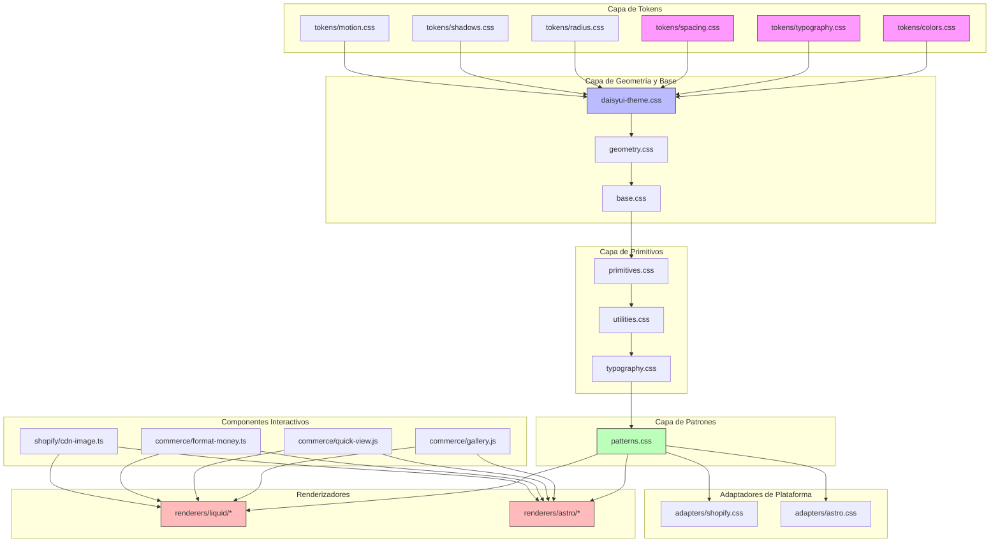
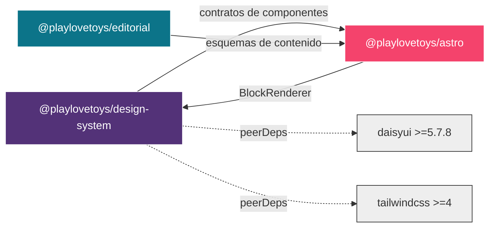
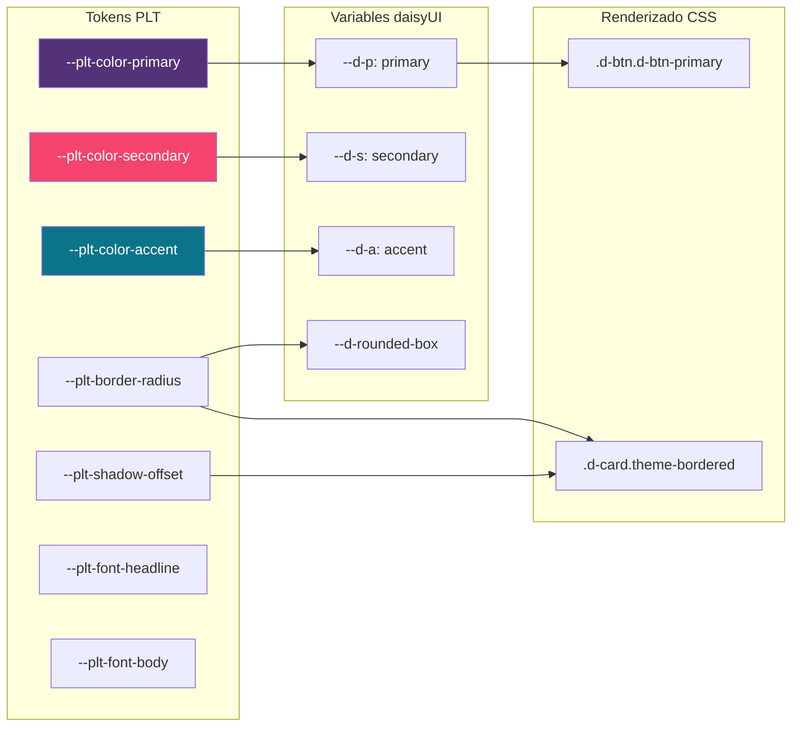
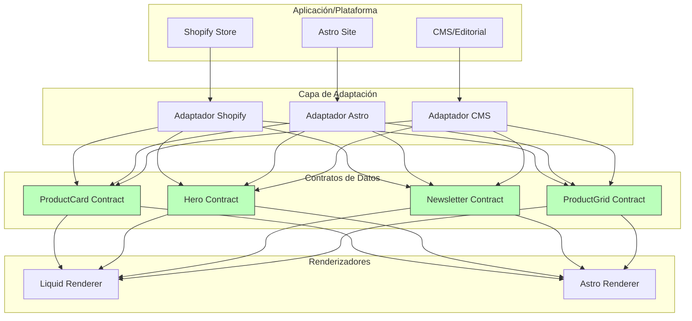
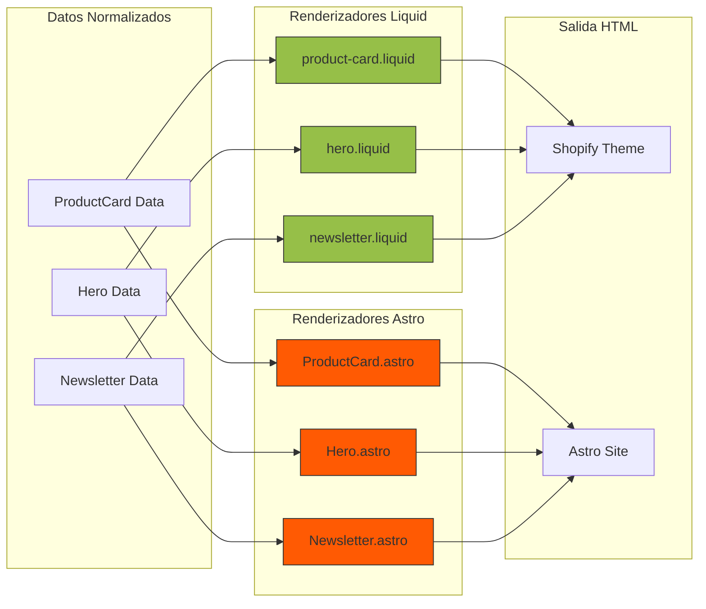
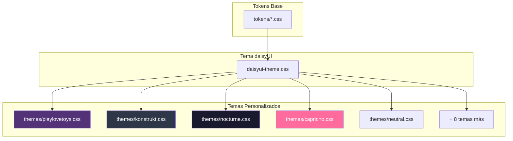
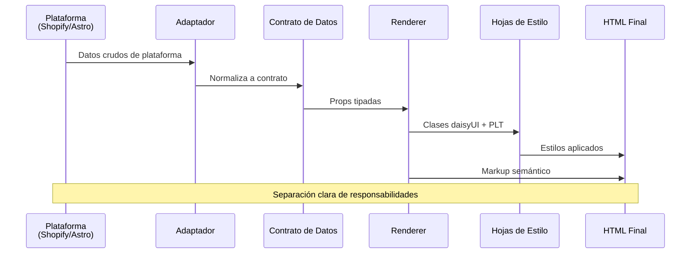
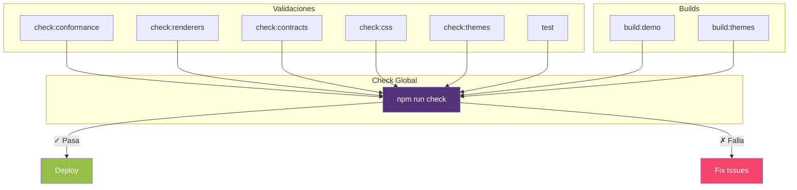

# Sistema de Diseño Play, love & Toys

Sistema de diseño portable, componible y multiplataforma que proporciona fundamentos visuales, primitivos, patrones composicionales y renderizadores cross-platform para la plataforma **Play, love & Toys**.

---

## Arquitectura General

El sistema de diseño PLT está construido sobre una arquitectura de capas que separa tokens de diseño, primitivos visuales, patrones composicionales y renderizadores específicos de plataforma.



### Principios Arquitectónicos

1. **daisyUI-first**: daisyUI 5 posee la anatomía, estados y variantes de componentes
2. **Separación de Responsabilidades**: Tokens → Primitivos → Patrones → Renderers
3. **Multiplataforma**: Renderizadores agnósticos para Liquid (Shopify) y Astro
4. **Contratos de Componentes**: Interfaces de datos neutrales sin dependencias de plataforma
5. **Extensibilidad**: Sistema de temas personalizable con variables CSS

---

## Dependencias entre Paquetes



### Descripción de Paquetes

- **@playlovetoys/design-system**: Sistema de diseño core con CSS, componentes JS y renderers
- **@playlovetoys/editorial**: Esquemas JSON para páginas editoriales e islas de hidratación
- **@playlovetoys/astro**: Integración con Astro, incluye `BlockRenderer.astro`

---

## Sistema de Tokens de Diseño

Los tokens de diseño son las variables de decisión fundamentales del sistema. Se definen como custom properties CSS (`--plt-*`) y se mapean a las variables de tema de daisyUI.



### Categorías de Tokens

#### **Colores** (`tokens/colors.css`)

```css
--plt-color-primary: #533278;        /* Morado primario */
--plt-color-secondary: #F4436C;      /* Rosa secundario */
--plt-color-accent: #0C7489;         /* Azul acento */
--plt-color-base-100: #FAF7F2;       /* Superficie base */
--plt-color-base-200: #F0EBE3;       /* Superficie elevada */
--plt-color-base-300: #E6DFD4;       /* Superficie hundida */
--plt-color-base-content: oklch(37% 0.044 257.287);  /* Contenido base */
```

#### **Tipografía** (`tokens/typography.css`)

```css
--plt-font-headline: "Fjalla One", sans-serif;     /* Titulares display */
--plt-font-body: "Atkinson Hyperlegible", sans-serif;  /* Cuerpo de texto */
--plt-font-accent: "Space Grotesk", sans-serif;    /* Labels y acentos */
--plt-headline-transform: uppercase;                /* Mayúsculas display */
--plt-headline-tracking: -0.02em;                  /* Tracking apretado */
--plt-label-weight: 700;                           /* Peso de labels */
```

#### **Espaciado** (`tokens/spacing.css`)

```css
--plt-page-margin: clamp(1rem, 4vw, 2rem);         /* Margen de página */
--plt-page-width: 80rem;                            /* Ancho máximo */
--plt-section-gap: clamp(3rem, 8vw, 6rem);         /* Espacio entre secciones */
```

#### **Geometría** (`tokens/radius.css`, `tokens/shadows.css`)

```css
--plt-border-radius: 0.25rem;                      /* Radio base */
--plt-border-width: 2px;                           /* Borde de componente */
--plt-section-border-width: 3px;                   /* Borde de sección */
--plt-shadow-offset: 4px;                          /* Offset de sombra */
--plt-shadow-hover-offset: 8px;                    /* Offset hover */
--plt-shadow-active-offset: 2px;                   /* Offset activo */
--plt-shadow-color: oklch(37% 0.044 257.287 / 0.15);
```

#### **Movimiento** (`tokens/motion.css`)

```css
--plt-transition-fast: 150ms;
--plt-transition-base: 300ms;
--plt-transition-slow: 500ms;
--plt-easing-standard: cubic-bezier(0.4, 0.0, 0.2, 1);
```

---

## Primitivos Visuales

Los primitivos son utilidades reutilizables que extienden daisyUI con el lenguaje visual PLT.

### Utilidades de Tema

#### `.theme-elevated`

Añade sombra dura con offset sin blur, característica del estilo neo-brutalista.

```html
<button class="d-btn d-btn-primary theme-elevated">
  Botón Elevado
</button>
```

**Comportamiento**:
- Estado base: offset 4px
- Hover: offset 8px + traslado -2px
- Active: offset 2px + traslado +2px

#### `.theme-bordered`

Aplica borde visible de 3px con el color de tema.

```html
<div class="d-card theme-bordered theme-elevated">
  Tarjeta con borde
</div>
```

#### `.theme-label-bold`

Aplica la tipografía de labels: fuente accent, peso 700, tracking ajustado, opcional uppercase.

```html
<span class="d-badge d-badge-secondary theme-label-bold">Nuevo</span>
```

### Utilidades de Tipografía

```html
<!-- Headlines -->
<h1 class="theme-headline-lg">Titular Grande</h1>
<h2 class="theme-headline-md">Titular Medio</h2>
<h3 class="theme-headline-sm">Titular Pequeño</h3>

<!-- Body -->
<p class="theme-body-lg">Cuerpo grande</p>
<p class="theme-body-md">Cuerpo medio</p>
<p class="theme-body-sm">Cuerpo pequeño</p>

<!-- Meta -->
<span class="theme-meta">Texto secundario</span>
```

---

## Contratos de Componentes

Los contratos definen interfaces de datos neutrales para los renderizadores visuales, excluyendo objetos de Shopify, colecciones de contenido de Astro y estado en tiempo de ejecución.



### ProductCard

**Requeridos**: `title`, `url`, `price`

**Opcionales**: `image_url`, `image_alt`, `vendor`, `compare_at_price`, `badge`, `action_label`, `action_url`

```typescript
interface ProductCard {
  title: string;
  url: string;
  price: string;  // Ya formateado
  image_url?: string;
  image_alt?: string;
  vendor?: string;
  compare_at_price?: string;  // Ya formateado
  badge?: string;
  action_label?: string;
  action_url?: string;
}
```

**Hooks de Estilo**:
- `.plt-product-card__hover-media`: Segunda imagen mostrada al hover
- `.plt-product-card--row`: Layout horizontal en móviles

### Hero

**Requeridos**: `heading`

**Opcionales**: `eyebrow`, `body`, `image_url`, `image_alt`, `primary_label`, `primary_url`, `secondary_label`, `secondary_url`

```typescript
interface Hero {
  heading: string;
  eyebrow?: string;
  body?: string;
  image_url?: string;
  image_alt?: string;
  primary_label?: string;
  primary_url?: string;
  secondary_label?: string;
  secondary_url?: string;
}
```

### Newsletter

**Requeridos**: `heading`

**Opcionales**: `body`, `form_action`, `method`, `input_name`, `input_placeholder`, `action_label`

```typescript
interface Newsletter {
  heading: string;
  body?: string;
  form_action?: string;
  method?: string;
  input_name?: string;
  input_placeholder?: string;
  action_label?: string;
}
```

### ProductGrid

**Opcionales**: `columns` (2 | 3 | 4)

Los hijos/bloque de renderizado suministran instancias de ProductCard.

**Comportamiento Responsivo**:

| `columns` | < 40rem | 40–64rem | ≥ 64rem |
|-----------|---------|----------|---------|
| _(none)_  | 2       | 3        | 4       |
| `2`       | 2       | 2        | 2       |
| `3`       | 1       | 3        | 3       |
| `4`       | 2       | 3        | 4       |

### Price

**Requeridos**: `locale` (etiqueta BCP 47), `price` (objeto Money)

**Opcionales**: `compareAtPrice`, `minPrice`, `maxPrice`

```typescript
interface Money {
  amount: string;  // String decimal
  currencyCode: string;  // Código ISO 4217
}

interface Price {
  locale: string;
  price: Money;
  compareAtPrice?: Money;
  minPrice?: Money;
  maxPrice?: Money;
}
```

### Otros Contratos Disponibles

- **CollectionCard**: `title`, `url`, `image_url?`, `image_alt?`, `description?`
- **PromoStrip**: `heading`, `body?`, `action_label?`, `action_url?`, `tone?`
- **ProductDetail**: `title`, `price`, `vendor?`, `compare_at_price?`, `badge?`, `description?`, `images?[]`
- **CartLine**: `title`, `price`, `url?`, `image_url?`, `variant_label?`, `quantity?`
- **CartSummary**: `subtotal`, `heading?`, `checkout_url?`, `checkout_label?`
- **Breadcrumbs**: `items[]`, `aria_label?`
- **Navbar**: `site_name`, `links[]`, `logo_url?`, `home_url?`
- **Footer**: `site_name`, `logo_url?`, `columns?[]`, `social?[]`
- **FilterBar**: `filters[]`, `action?`, `method?`, `submit_label?`
- **SortSelect**: `options[]`, `name?`, `label?`, `action?`
- **Pagination**: `pages[]`, `prev_url?`, `next_url?`
- **EmptyState**: `heading`, `body?`, `tone?`, `action_label?`, `action_url?`

Ver documentación completa en `contracts/components.md`.

---

## Componentes Interactivos

### ProductGallery (Web Component)

Custom element para galería de imágenes de producto con thumbnails.

**Ubicación**: `src/commerce/gallery.js`

**Uso**:

```html
<plt-product-gallery>
  <div class="plt-product-detail__gallery-main">
    
  </div>
  <div class="plt-product-detail__thumbs">
    <button class="plt-product-detail__thumb" aria-current="true">
      
    </button>
    <button class="plt-product-detail__thumb">
      
    </button>
  </div>
</plt-product-gallery>
```

**API**:

| Método/Propiedad | Descripción |
|------------------|-------------|
| `connectedCallback()` | Inicializa el componente y eventos |
| `disconnectedCallback()` | Limpia event listeners |
| `handleThumbClick(e)` | Maneja click en thumbnail |
| `thumbs` | Array de elementos thumb |
| `mainImage` | Elemento de imagen principal |

**Características**:
- Auto-registra el custom element si no existe
- Gestión de estado `aria-current` automática
- Actualización de imagen principal al hacer click en thumbnail
- Inicializa primer thumb como actual si ninguno está seleccionado
- Limpieza automática de event listeners al desconectarse

### ProductQuickView (Web Component)

Modal de vista rápida de producto usando `<dialog>` nativo.

**Ubicación**: `src/commerce/quick-view.js`

**Uso**:

```html
<plt-quick-view>
  <button data-quick-view-open>Vista Rápida</button>
  <dialog>
    <div class="plt-quick-view__content">
      <!-- Contenido del producto -->
      <button data-quick-view-close>Cerrar</button>
    </div>
  </dialog>
</plt-quick-view>
```

**API**:

| Método | Descripción |
|--------|-------------|
| `open()` | Abre el modal (`showModal()`) |
| `close()` | Cierra el modal |
| `handleOutsideClick(e)` | Cierra al hacer click en backdrop |
| `handleDialogClose()` | Limpieza al cerrar |

**Características**:
- Gestión de focus: guarda y restaura el elemento con foco anterior
- Prevención de scroll del body cuando está abierto (gestión global compartida)
- Soporte para múltiples dialogs abiertos simultáneamente
- Cierre al hacer click fuera del contenido (verificación precisa de coordenadas)
- Cierre automático con ESC (nativo de `<dialog>`)
- Set global `openDialogs` para coordinar estado entre múltiples instancias

### Utilidades de Formato de Dinero

**Ubicación**: `src/commerce/format-money.ts`

#### `formatMoney(money: Money, locale: string): string`

Formatea un objeto Money usando `Intl.NumberFormat`.

```typescript
const price = { amount: "48.00", currencyCode: "USD" };
formatMoney(price, "es-ES"); // "48,00 US$"
```

**Parámetros**:
- `money`: Objeto `{ amount: string, currencyCode: string }`
- `locale`: Etiqueta BCP 47 (ej: `"en-US"`, `"es-ES"`)

**Retorna**: String formateado o el `amount` original si no es un número válido

#### `formatPriceRange(min: Money, max: Money, locale: string): string`

Formatea un rango de precios.

```typescript
formatPriceRange(
  { amount: "20.00", currencyCode: "USD" },
  { amount: "50.00", currencyCode: "USD" },
  "en-US"
); // "$20.00 – $50.00"
```

#### `formatPriceDisplay(locale: string, price: Money, options?): { display, compareDisplay }`

Formatea precio con opciones para precio de comparación y rangos.

```typescript
formatPriceDisplay("en-US", price, {
  compareAtPrice: { amount: "60.00", currencyCode: "USD" },
  minPrice: { amount: "40.00", currencyCode: "USD" },
  maxPrice: { amount: "80.00", currencyCode: "USD" }
});
// { display: "$40.00 – $80.00", compareDisplay: "$60.00" }
```

**Retorna**: Objeto con `display` (precio o rango) y `compareDisplay` (precio de comparación o `null`)

### Utilidades de CDN de Shopify

**Ubicación**: `src/shopify/cdn-image.ts`

#### `isShopifyCdnUrl(url: string): boolean`

Verifica si una URL es del CDN de Shopify (`cdn.shopify.com` o subdominios).

```typescript
isShopifyCdnUrl("https://cdn.shopify.com/..."); // true
isShopifyCdnUrl("https://example.com/image.jpg"); // false
```

#### `shopifyCdnUrl(url: string, options: { width: number; height?: number }): string`

Genera URL del CDN con parámetros de dimensión.

```typescript
shopifyCdnUrl(imageUrl, { width: 800 });
shopifyCdnUrl(imageUrl, { width: 800, height: 600 });
```

**Retorna**: URL modificada con query params `?width=X&height=Y` o URL original si no es CDN de Shopify

#### `shopifyCdnSrcSet(url: string, widths: readonly number[]): string`

Genera atributo `srcset` para imágenes responsive.

```typescript
shopifyCdnSrcSet(imageUrl, [400, 800, 1200]);
// "https://...?width=400 400w, https://...?width=800 800w, ..."
```

**Retorna**: String vacío si no es CDN de Shopify o si `widths` está vacío

#### Presets de Ancho

```typescript
export const SHOPIFY_CDN_WIDTHS = {
  card: [200, 400, 600, 800],
  collection: [300, 600, 900],
  gallery: [400, 800, 1200, 1600],
} as const;

export const SHOPIFY_CDN_SIZES = {
  card: "(min-width: 1024px) 25vw, (min-width: 640px) 33vw, 50vw",
  collection: "(min-width: 1024px) 33vw, (min-width: 640px) 50vw, 100vw",
  gallery: "(min-width: 1024px) 50vw, 100vw",
};
```

**Ejemplo de uso con preset**:

```html

```

---

## Renderizadores Multiplataforma

El sistema proporciona renderizadores para Liquid (Shopify) y Astro que implementan los contratos de componentes.



### Renderizadores Liquid

Ubicados en `renderers/liquid/`, estos componentes están diseñados para integrarse en temas de Shopify.

**Convenciones de Nomenclatura**:
- Snake_case para nombres de archivo: `product-card.liquid`, `hero.liquid`
- Props pasadas mediante objetos Liquid o argumentos individuales

**Ejemplo de Uso**:

```liquid

```

### Renderizadores Astro

Ubicados en `renderers/astro/`, estos componentes son para sitios Astro.

**Convenciones de Nomenclatura**:
- PascalCase para nombres de archivo: `ProductCard.astro`, `Hero.astro`
- Props tipadas con TypeScript

**Ejemplo de Uso**:

```astro
---
import ProductCard from '@playlovetoys/design-system/renderers/astro/ProductCard.astro';
---

<ProductCard
  title="Velvet Pulse"
  url="/products/velvet-pulse"
  price="$48.00"
  imageUrl="/images/product.jpg"
  vendor="PLT Essentials"
  badge="Nuevo"
/>
```

### Organización por Categorías

```
renderers/
├── astro/
│   ├── product/          # Componentes de producto
│   ├── commerce/         # Funcionalidad comercial
│   ├── cart/             # Carrito de compras
│   ├── collection/       # Colecciones
│   ├── layout/           # Layout y secciones
│   ├── editorial/        # Contenido editorial
│   ├── navigation/       # Navegación
│   └── ui/               # UI genérica
└── liquid/               # Misma estructura
```

**Componentes Disponibles** (ambas plataformas):

| Categoría | Componentes |
|-----------|-------------|
| **product** | ProductCard, ProductGrid, ProductDetail, ProductQuickView |
| **commerce** | Price, Stock, OptionPicker, QuantitySelector, CartSummary, ReviewRating, ReviewCard, IncentiveBar, ResponsiveShopifyImage |
| **cart** | CartDrawer, CartLine |
| **collection** | CollectionCard, FilterBar, SortSelect |
| **layout** | Hero, PromoStrip, Footer |
| **editorial** | Newsletter, EditorialCard, SplitCta, SectionHeader |
| **navigation** | Navbar, Breadcrumbs |
| **ui** | SearchField, Pagination, EmptyState |

---

## Sistema de Temas

PLT proporciona un sistema de temas extensible basado en variables CSS.



### Temas Disponibles

El sistema incluye 13 temas predefinidos:

| Tema | Descripción | Colores Principales |
|------|-------------|---------------------|
| **playlovetoys** | Tema por defecto | Morado (#533278), Rosa (#F4436C) |
| **konstrukt** | Industrial técnico | Grises neutros |
| **nocturne** | Modo oscuro elegante | Azul marino oscuro |
| **capricho** | Vibrante y juguetón | Pasteles vivos |
| **neutral** | Minimalista limpio | Grises puros |
| **playdoh** | Colorido y divertido | Multicolor brillante |
| **unconventionals** | Atrevido experimental | Contrastes audaces |
| **broadsheet** | Editorial clásico | Blanco y negro |
| **cheesecake** | Suave y cremoso | Beige y dorados |
| **workbench** | Utilitario robusto | Tonos tierra |
| **plt** | Variante principal | Similar a playlovetoys |
| **docs** | Optimizado para docs | Azul y gris |
| **docs-light** | Docs claro | Blanco y azul suave |

### Aplicación de Temas

**En HTML**:

```html
<html data-theme="playlovetoys">
  <!-- Contenido -->
</html>
```

**En Tailwind Config** (Tailwind 4):

```js
import daisyui from 'daisyui';

export default {
  plugins: [daisyui],
  daisyui: {
    themes: ['playlovetoys', 'konstrukt', 'nocturne'],
    prefix: 'd-',
  },
};
```

**Importación de CSS**:

```css
@import "@playlovetoys/design-system/themes/playlovetoys.css";
```

### Creación de Temas Personalizados

Para crear un tema personalizado, sobrescribe las variables `--plt-*` y mapea a daisyUI:

```css
[data-theme="mi-tema"] {
  /* Colores */
  --plt-color-primary: #your-color;
  --plt-color-secondary: #your-color;
  --plt-color-accent: #your-color;
  --plt-color-base-100: #your-bg;
  
  /* Geometría */
  --plt-border-radius: 0.5rem;
  --plt-shadow-offset: 6px;
  
  /* Tipografía */
  --plt-font-headline: "Your Font", sans-serif;
  --plt-headline-transform: none;
  
  /* Mapeo a daisyUI (requerido) */
  --d-p: var(--plt-color-primary);
  --d-s: var(--plt-color-secondary);
  --d-a: var(--plt-color-accent);
  --d-b1: var(--plt-color-base-100);
  --d-b2: var(--plt-color-base-200);
  --d-b3: var(--plt-color-base-300);
  --d-bc: var(--plt-color-base-content);
  --d-rounded-box: var(--plt-border-radius);
}
```

**Generación de Temas**: El script `scripts/build-themes.mjs` genera automáticamente archivos CSS de temas desde definiciones centralizadas.

**Validación**: El script `scripts/check-theme-rules.mjs` valida que todos los temas definan las variables requeridas.

---

## Flujo de Datos y Renderizado



### Ejemplo de Flujo Completo

**1. Datos de Shopify** (raw):

```liquid

```

**2. Adaptador normaliza a contrato**:

```liquid

```

**3. Renderer recibe datos del contrato**:

```liquid

```

**4. Renderer genera HTML con clases PLT**:

```html
<article class="d-card bg-base-100 theme-bordered theme-elevated plt-media-card plt-product-card">
  <div class="plt-media-card__media">
    
  </div>
  <div class="d-card-body plt-media-card__body">
    <h3 class="d-card-title theme-headline-sm">Velvet Pulse</h3>
    <p class="theme-meta">PLT Essentials</p>
    <div class="d-card-actions plt-media-card__actions">
      <span class="plt-product-card__price">$48.00</span>
      <button class="d-btn d-btn-secondary theme-elevated">Añadir</button>
    </div>
  </div>
</article>
```

---

## Desarrollo y Validación

El sistema incluye múltiples scripts de validación para garantizar calidad y conformidad.



### Scripts de Validación

| Script | Propósito | Implementación |
|--------|-----------|----------------|
| `check:conformance` | Valida conformidad con convenciones daisyUI | `scripts/check-daisyui-conformance.mjs` |
| `check:renderers` | Valida seguridad y correctitud de renderizadores | `scripts/check-renderer-safety.mjs` |
| `check:contracts` | Valida consistencia de contratos de componentes | `scripts/check-commerce-contracts.mjs` |
| `check:css` | Linting de CSS con Stylelint | Configurado en `.stylelintrc.json` |
| `check:themes` | Valida variables requeridas en temas | `scripts/check-theme-rules.mjs` |
| `test` | Suite de tests con Vitest | `vitest.config.ts` |
| `build:demo` | Compila CSS de demostración | Tailwind CLI |
| `build:themes` | Genera temas CSS | `scripts/build-themes.mjs` |
| `check` | Ejecuta todas las validaciones | Orquestador |

### Tests Automatizados

**Ubicación**: `src/commerce/__tests__/`

**Framework**: Vitest con jsdom

**Cobertura**:
- Funciones de formato de dinero (`format-money.test.ts`)
- Utilidades de CDN de Shopify (`cdn-image.test.ts`)
- Componentes web (`gallery.test.ts`, `quick-view.test.ts`)

**Configuración** (`vitest.config.ts`):

```typescript
import { defineConfig } from "vitest/config";

export default defineConfig({
  test: {
    environment: "jsdom",
  },
});
```

### Flujo de CI/CD

**GitHub Actions** ejecuta validaciones automáticas en cada PR y push:

#### Conformidad con daisyUI
- **Workflow**: `.github/workflows/daisyui-conformance.yml`
- **Trigger**: PR y push a main
- **Ejecuta**: `npm run check` (todas las validaciones)

#### Build de Documentación
- **Workflow**: `.github/workflows/zensical-docs.yml`
- **Trigger**: PR y push
- **Ejecuta**: `npm run docs:build:all`
- **Requiere**: Python 3.12 + Node 20

#### Deploy a Cloudflare Pages
- **Workflow**: `.github/workflows/deploy-docs.yml`
- **Trigger**: Push a main, manual
- **Deploy**: Cloudflare Pages (`plt-docs`)
- **Configuración**: `wrangler.toml`

---

## Guías de Integración

### Integración en Shopify

**1. Instalación de dependencias** (`package.json`):

```json
{
  "dependencies": {
    "@playlovetoys/design-system": "^0.7.0",
    "daisyui": ">=5.7.8 <6",
    "tailwindcss": ">=4 <5"
  }
}
```

**2. Configuración de Tailwind** (`tailwind.config.js`):

```js
import daisyui from 'daisyui';

export default {
  content: [
    './sections/**/*.liquid',
    './snippets/**/*.liquid',
    './templates/**/*.liquid',
    './layout/**/*.liquid',
  ],
  plugins: [daisyui],
  daisyui: {
    themes: ['playlovetoys'],
    prefix: 'd-',
  },
};
```

**3. Importación en theme.liquid**:

```liquid
 layout/theme.liquid 
<head>
  {{ '@playlovetoys/design-system' | asset_url | stylesheet_tag }}
  {{ '@playlovetoys/design-system/shopify' | asset_url | stylesheet_tag }}
  <script src="{{ '@playlovetoys/design-system/commerce/gallery.js' | asset_url }}" defer></script>
  <script src="{{ '@playlovetoys/design-system/commerce/quick-view.js' | asset_url }}" defer></script>
</head>
```

**4. Uso de renderizadores** (ejemplo: sección de grid de productos):

```liquid
 sections/product-grid.liquid 
<div class="plt-product-grid plt-product-grid--cols-3">
  
    
  
</div>
```

### Integración en Astro

**1. Instalación de dependencias** (`package.json`):

```json
{
  "dependencies": {
    "@playlovetoys/design-system": "^0.7.0",
    "@playlovetoys/astro": "^0.1.0",
    "@playlovetoys/editorial": "^0.1.0",
    "daisyui": ">=5.7.8 <6",
    "tailwindcss": ">=4 <5"
  }
}
```

**2. Configuración de Tailwind** (`tailwind.config.mjs`):

```js
import daisyui from 'daisyui';

export default {
  content: ['./src/**/*.{astro,html,js,jsx,md,mdx,svelte,ts,tsx,vue}'],
  plugins: [daisyui],
  daisyui: {
    themes: ['playlovetoys'],
    prefix: 'd-',
  },
};
```

**3. Layout base** (`src/layouts/Base.astro`):

```astro
---
import '@playlovetoys/design-system';
import '@playlovetoys/design-system/astro';
---

<html data-theme="playlovetoys">
  <head>
    <meta charset="utf-8" />
    <meta name="viewport" content="width=device-width" />
    <title>{Astro.props.title}</title>
  </head>
  <body>
    <slot />
    <script src="@playlovetoys/design-system/commerce/gallery.js"></script>
    <script src="@playlovetoys/design-system/commerce/quick-view.js"></script>
  </body>
</html>
```

**4. Uso de componentes**:

```astro
---
import ProductCard from '@playlovetoys/design-system/renderers/astro/product/ProductCard.astro';
import Hero from '@playlovetoys/design-system/renderers/astro/layout/Hero.astro';

const products = await getProducts();
---

<Hero
  heading="Bienvenido a PLT"
  body="Descubre nuestra colección"
  primaryLabel="Comprar Ahora"
  primaryUrl="/shop"
/>

<div class="plt-product-grid plt-product-grid--cols-3">
  {products.map(product => (
    <ProductCard
      title={product.title}
      url={product.url}
      price={product.price}
      imageUrl={product.imageUrl}
    />
  ))}
</div>
```

**5. Renderizado editorial con BlockRenderer**:

```astro
---
import BlockRenderer from '@playlovetoys/astro/BlockRenderer.astro';
import pageData from '../data/home.json';
---

<BlockRenderer blocks={pageData.blocks} />
```

---

## Exports del Paquete

El paquete expone múltiples puntos de entrada configurados en `package.json`:

```json
{
  "exports": {
    ".": "./src/index.css",
    "./tokens": "./src/tokens.css",
    "./tokens/*": "./src/tokens/*",
    "./typography": "./src/typography.css",
    "./geometry": "./src/geometry.css",
    "./utilities": "./src/utilities.css",
    "./primitives": "./src/primitives.css",
    "./patterns": "./src/patterns.css",
    "./daisyui": "./src/daisyui-theme.css",
    "./shopify": "./adapters/shopify.css",
    "./astro": "./adapters/astro.css",
    "./contracts": "./contracts/components.md",
    "./renderers/liquid/*": "./renderers/liquid/*",
    "./renderers/astro/*": "./renderers/astro/*",
    "./base": "./src/base.css",
    "./themes/*": "./themes/*.css"
  }
}
```

### Ejemplos de Importación

**Completo**:

```css
@import "@playlovetoys/design-system";
```

**Granular**:

```css
@import "@playlovetoys/design-system/tokens";
@import "@playlovetoys/design-system/primitives";
@import "@playlovetoys/design-system/patterns";
```

**Tokens específicos**:

```css
@import "@playlovetoys/design-system/tokens/colors.css";
@import "@playlovetoys/design-system/tokens/typography.css";
```

**Tema**:

```css
@import "@playlovetoys/design-system/themes/nocturne.css";
```

**Renderizadores desde JavaScript/TypeScript**:

```typescript
import ProductCard from '@playlovetoys/design-system/renderers/astro/product/ProductCard.astro';
import { formatMoney } from '@playlovetoys/design-system/commerce/format-money';
import { shopifyCdnUrl } from '@playlovetoys/design-system/shopify/cdn-image';
```

---

## Dirección Visual y Lenguaje de Diseño

### Neo-Brutalismo Suave

Lenguaje visual **neo-brutalista suave** según `DESIGN.md`: limpio, audaz, juguetón y de alto contraste.

**Características principales**:

1. **Superficies cerca-blancas**: Base crema (#FAF7F2) en lugar de blanco puro
2. **Tipografía display en mayúsculas**: Titulares bold, tracking apretado (-0.02em)
3. **Bordes visibles**: 2-3px de grosor, coloreados y prominentes
4. **Sombras duras**: Offset sin blur (4px/8px), nunca sombras suaves
5. **Alto contraste**: Colores saturados contra superficies claras
6. **Esquinas suaves**: 0.25rem, no pills extremos

**Evitar**:
- Glassmorfismo
- Gradientes suaves
- Formas pill (border-radius extremo)
- Sombras difuminadas (box-shadow con blur)
- Colores pasteles muy desaturados en superficies principales

### Tipografía

**Jerarquía completa**:

```css
/* Display Headlines - Fjalla One */
--plt-font-headline: "Fjalla One", sans-serif;
--plt-headline-transform: uppercase;
--plt-headline-tracking: -0.02em;

.theme-headline-lg   /* 2.5rem / 40px */
.theme-headline-md   /* 2rem / 32px */
.theme-headline-sm   /* 1.5rem / 24px */

/* Body Text - Atkinson Hyperlegible */
--plt-font-body: "Atkinson Hyperlegible", sans-serif;

.theme-body-lg       /* 1.125rem / 18px */
.theme-body-md       /* 1rem / 16px */
.theme-body-sm       /* 0.875rem / 14px */

/* Accent Labels - Space Grotesk */
--plt-font-accent: "Space Grotesk", sans-serif;
--plt-label-weight: 700;
--plt-label-transform: uppercase;

.theme-meta          /* 0.75rem / 12px */
```

**Fuentes**:
- **Fjalla One**: Display sans-serif condensada, ideal para titulares impactantes
- **Atkinson Hyperlegible**: Diseñada específicamente para legibilidad, ideal para cuerpo de texto
- **Space Grotesk**: Geométrica moderna, perfecta para labels y UI

---

## Estructura de Directorios

```
packages/design-system/
├── src/                          # Código fuente CSS
│   ├── tokens/                   # Tokens de diseño
│   │   ├── colors.css
│   │   ├── typography.css
│   │   ├── spacing.css
│   │   ├── radius.css
│   │   ├── shadows.css
│   │   ├── breakpoints.css
│   │   ├── motion.css
│   │   └── index.css
│   ├── commerce/                 # Componentes comerciales
│   │   ├── gallery.js            # Web Component galería
│   │   ├── quick-view.js         # Web Component quick view
│   │   ├── format-money.ts       # Utilidades de formato
│   │   ├── format-money.test.ts
│   │   └── __tests__/
│   ├── shopify/                  # Utilidades Shopify
│   │   ├── cdn-image.ts          # Utilidades CDN
│   │   └── cdn-image.test.ts
│   ├── index.css                 # Entry point principal
│   ├── tokens.css                # Tokens agregados
│   ├── base.css                  # Estilos base
│   ├── geometry.css              # Geometría y layout
│   ├── primitives.css            # Primitivos visuales (theme-*)
│   ├── utilities.css             # Utilidades
│   ├── typography.css            # Tipografía (theme-headline-*, etc)
│   ├── patterns.css              # Patrones composicionales (plt-*)
│   └── daisyui-theme.css         # Mapeo PLT → daisyUI
├── adapters/                     # Adaptadores de plataforma
│   ├── shopify.css
│   └── astro.css
├── renderers/                    # Renderizadores multiplataforma
│   ├── astro/
│   │   ├── product/              # ProductCard, ProductGrid, etc
│   │   ├── commerce/             # Price, Stock, OptionPicker, etc
│   │   ├── cart/                 # CartDrawer, CartLine
│   │   ├── collection/           # CollectionCard, FilterBar, etc
│   │   ├── layout/               # Hero, PromoStrip, Footer
│   │   ├── editorial/            # Newsletter, EditorialCard, etc
│   │   ├── navigation/           # Navbar, Breadcrumbs
│   │   └── ui/                   # SearchField, Pagination, etc
│   └── liquid/                   # Misma estructura
├── themes/                       # 13 temas predefinidos
│   ├── playlovetoys.css
│   ├── konstrukt.css
│   ├── nocturne.css
│   └── ...
├── contracts/                    # Contratos de componentes
│   └── components.md             # Documentación de interfaces
├── scripts/                      # Scripts de validación y build
│   ├── check-daisyui-conformance.mjs
│   ├── check-renderer-safety.mjs
│   ├── check-commerce-contracts.mjs
│   ├── check-theme-rules.mjs
│   └── build-themes.mjs
├── demo/                         # Demo y playground
│   ├── demo.css
│   └── dist.css
├── docs/                         # Documentación del paquete
│   └── javascripts/
│       └── plt-island-preview.js
├── DESIGN.md                     # Guía de diseño visual
├── package.json                  # Manifiesto y scripts
└── vitest.config.ts              # Configuración de tests
```

---

## Referencias y Recursos

### Dependencias Peer

- **[daisyUI](https://daisyui.com/)** `>=5.7.8 <6`: Biblioteca de componentes CSS
  - [Componentes](https://daisyui.com/components/)
  - [Temas](https://daisyui.com/docs/themes/)
  - [Personalización](https://daisyui.com/docs/customize/)
- **[Tailwind CSS](https://tailwindcss.com/)** `>=4 <5`: Framework de utilidades CSS
  - [Documentación v4](https://tailwindcss.com/docs)

### Paquetes Relacionados PLT

Ver documentación específica para cada paquete:

- **@playlovetoys/editorial**: Esquemas de contenido editorial (page.schema.json, hydration-island.schema.json)
- **@playlovetoys/astro**: Integración con Astro (BlockRenderer.astro)

### Fuentes Tipográficas

- [Atkinson Hyperlegible](https://brailleinstitute.org/freefont) - Fuente de alta legibilidad del Braille Institute
- [Fjalla One](https://fonts.google.com/specimen/Fjalla+One) - Display sans-serif condensada
- [Space Grotesk](https://fonts.google.com/specimen/Space+Grotesk) - Sans-serif geométrica moderna

### Herramientas de Desarrollo

- **[Vitest](https://vitest.dev/)**: Framework de testing
- **[Stylelint](https://stylelint.io/)**: Linter de CSS
- **[Zensical](https://zensical.dev/)**: Generador de documentación (configurado en `zensical.toml`)

---

## Conclusión

El sistema de diseño **Play, love & Toys** proporciona una fundación visual sólida, componible y multiplataforma para construir experiencias de comercio editorial consistentes. Con su arquitectura en capas, contratos de datos neutrales y renderizadores multiplataforma, permite crear interfaces audaces, accesibles y de alta calidad tanto en Shopify como en Astro.

### Características Clave

✅ **Basado en daisyUI**: Aprovecha componentes probados en producción  
✅ **Multiplataforma**: Renderizadores para Liquid y Astro  
✅ **Tokens personalizables**: 13 temas predefinidos + sistema extensible  
✅ **Validación automática**: CI/CD con 6 validaciones diferentes  
✅ **Tipado fuerte**: Contratos de datos TypeScript bien definidos  
✅ **Accesible**: HTML semántico y ARIA donde corresponde  
✅ **Neo-brutalista**: Lenguaje visual audaz y distintivo  
✅ **Web Components**: Componentes nativos sin dependencias de framework  

### Recursos Adicionales

- **Contratos**: `contracts/components.md` documenta todas las APIs de componentes
- **Guía de Diseño**: `DESIGN.md` para directrices visuales completas
- **Demo**: `demo/` contiene ejemplos visuales y playground
- **Tests**: `src/commerce/__tests__/` para referencia de testing

---

**Versión del Documento**: 1.0  
**Última Actualización**: 2026-10-10  
**Versión del Paquete**: @playlovetoys/design-system@0.7.0  
**Documentación Generada**: Sistema automático CodeWiki
