# Sistema de Diseño PLT

Sistema de componentes visuales portátil para Play, love & Toys, construido sobre daisyUI 5 y Tailwind CSS 4.

## Introducción

El **PLT Design System** es una capa de diseño modular que proporciona fundamentos visuales, componentes primitivos, patrones compuestos y renderizadores multiplataforma para la marca Play, love & Toys. Este sistema está diseñado con una filosofía **daisyUI-first**, aprovechando la anatomía de componentes probada de daisyUI mientras aplica la identidad visual única de PLT.

### Alcance del Sistema

El sistema de diseño se enfoca exclusivamente en la capa visual y de componentes:

- **Tokens de diseño PLT** (`--plt-*`)
- **Tipografía y geometría** de marca
- **Tema `brand`** personalizado para daisyUI
- **Extensiones visuales PLT** como `theme-bordered`, `theme-elevated` y tipografía de etiquetas
- **Patrones compuestos** específicos de PLT
- **Renderizadores normalizados** para Liquid (Shopify) y Astro

**Fuera del alcance**: esquemas editoriales, lógica CMS, comportamiento de negocio Shopify, enrutamiento, estado del carrito, ciclo de vida de aplicación.

### Características Principales

- 🎨 **Identidad visual coherente** con dirección neo-brutalista suave
- 🧩 **Componentes reutilizables** basados en contratos visuales claros
- 🔄 **Renderizadores multiplataforma** (Liquid/Astro) que garantizan anatomía equivalente
- 📦 **Sistema de temas** con múltiples variantes de marca
- 🛒 **Componentes de comercio** especializados para e-commerce
- ⚡ **Integración Shopify CDN** optimizada para imágenes responsivas
- ✅ **Verificación automatizada** de conformidad y contratos

## Arquitectura del Sistema

### Diagrama de Capas

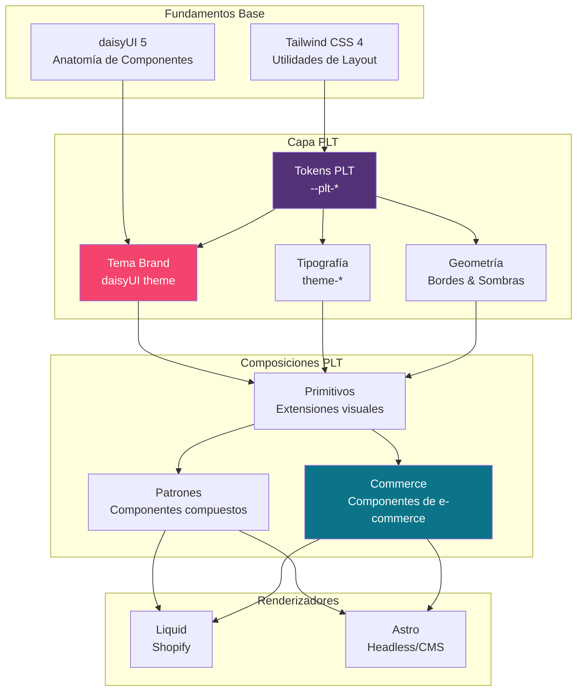

### Estructura de Archivos

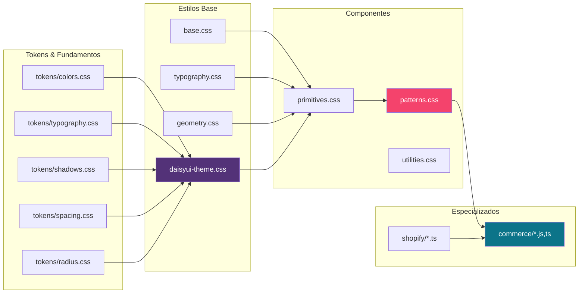

## Tokens de Diseño

### Sistema de Tokens

Los **custom properties `--plt-*`** son la fuente de verdad para todas las decisiones de marca PLT. Estos tokens se mapean al sistema de temas de daisyUI y se organizan en categorías semánticas.

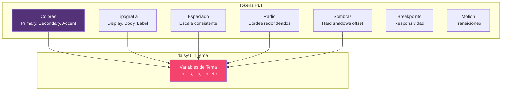

### Paleta de Color

Definida en `src/tokens/colors.css`:

- **Primary**: `#533278` (Morado PLT)
- **Secondary**: `#F4436C` (Rosa vibrante)
- **Accent**: `#0C7489` (Azul verdoso)
- **Base surface**: `#FAF7F2` (Off-white)
- **Base content**: `oklch(37% 0.044 257.287)` (Texto oscuro)

### Tipografía

Definida en `src/tokens/typography.css`:

- **Display**: Fjalla One (Titulares uppercase, bold)
- **Body**: Atkinson Hyperlegible (Texto de lectura)
- **Accent/Labels**: Space Grotesk (Etiquetas y UI)

### Geometría

Definida en `src/tokens/shadows.css` y `src/tokens/radius.css`:

- **Radio de campo**: `0.25rem`
- **Borde base**: `2px`
- **Borde de sección PLT**: `3px`
- **Offset de sombra base**: `4px`
- **Offset de sombra hover**: `8px`
- **Offset de sombra active**: `2px`

## Principio daisyUI-First

### Invariante de Diseño

**Todo componente con equivalente en daisyUI debe usar la clase prefijada oficial como base.**

Este principio fundamental asegura:
- Anatomía de componentes consistente y probada
- Estados y variantes mantenidos por daisyUI
- Actualizaciones del framework sin breaking changes
- Separación clara entre fundamentos y marca

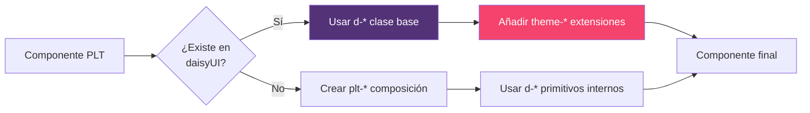

### Ejemplos de Uso

```html
<!-- Botón con tratamiento PLT -->
<button class="d-btn d-btn-primary theme-bordered theme-elevated theme-label-bold">
  Shop now
</button>

<!-- Card con estilo PLT -->
<article class="d-card bg-base-100 theme-bordered theme-elevated">
  <div class="d-card-body">
    <h2 class="d-card-title theme-headline-sm">Título</h2>
    <div class="d-card-actions">...</div>
  </div>
</article>

<!-- Badge con tipografía PLT -->
<span class="d-badge d-badge-secondary theme-label-bold">Nuevo</span>

<!-- Input base de daisyUI -->
<input class="d-input" type="email">
```

### Clases Prohibidas

- ❌ Primitivos paralelos: `plt-button`, `plt-card`, `plt-badge`, `plt-input`
- ❌ Modificadores obsoletos de daisyUI v5: `d-input-bordered`, `d-select-bordered`, `d-textarea-bordered`, `d-card-bordered`

Las extensiones `theme-*` se usan para tipografía y tratamiento de marca; `plt-*` se reserva para composiciones que daisyUI no proporciona.

## Sistema de Temas

### Temas Disponibles

El sistema incluye múltiples temas predefinidos en el directorio `themes/`:

- **plt.css**: Tema principal de la marca
- **neutral.css**: Variante neutral
- **nocturne.css**: Tema oscuro
- **playdoh.css**: Variante juguetona
- **konstrukt.css**: Estilo constructivista
- **capricho.css**: Tema caprichoso
- **broadsheet.css**: Estilo editorial
- **workbench.css**: Tema de trabajo
- **unconventionals.css**: Variante no convencional
- **playlovetoys.css**: Tema corporativo
- **cheesecake.css**: Variante dulce
- **docs.css** / **docs-light.css**: Temas para documentación

### Flujo de Generación de Temas

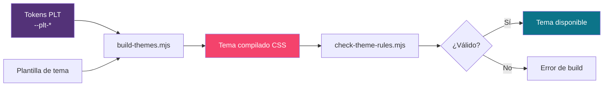

### Aplicación de Temas

Los temas se aplican mediante el atributo `data-theme`:

```html
<div data-theme="brand">
  <!-- Contenido con tema brand -->
</div>

<div data-theme="nocturne">
  <!-- Contenido con tema oscuro -->
</div>
```

## Componentes de Commerce

### Arquitectura de Componentes

El sistema incluye componentes especializados para e-commerce organizados en `src/commerce/`:

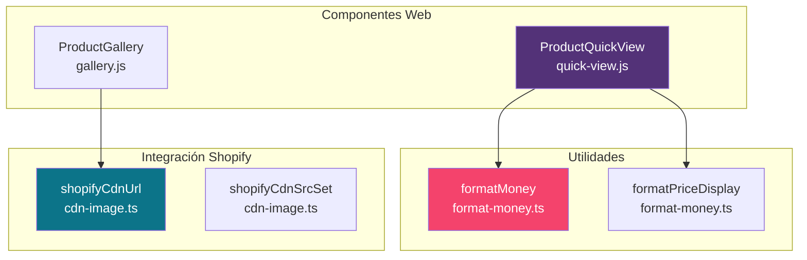

### ProductQuickView

Custom element que implementa un diálogo modal para vista rápida de productos.

**Características**:
- Gestión de diálogos múltiples abiertos simultáneamente
- Control del scroll del body cuando hay modales activos
- Restauración de foco al cerrar
- Cierre al hacer click fuera del contenido
- Event listeners limpios al desconectar

**Flujo de Interacción**:

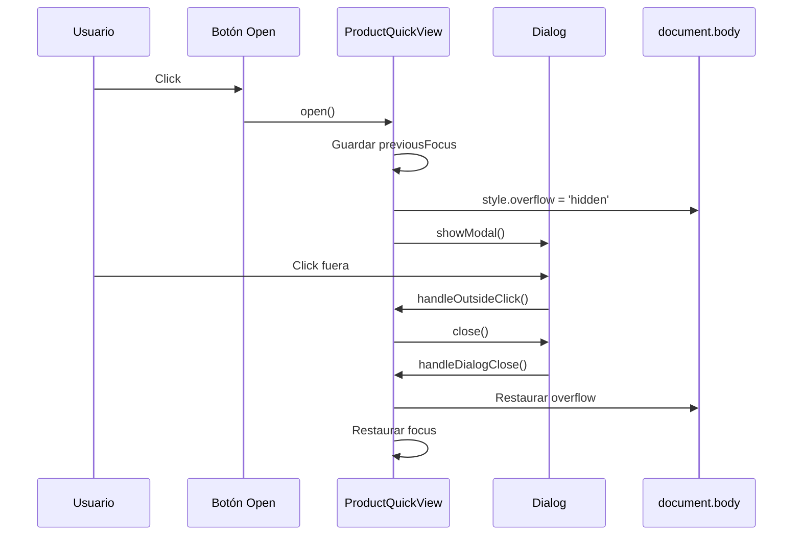

**Uso**:

```html
<plt-quick-view>
  <button data-quick-view-open>Ver detalles</button>
  <dialog>
    <div>
      <!-- Contenido del producto -->
      <button data-quick-view-close>Cerrar</button>
    </div>
  </dialog>
</plt-quick-view>
```

### ProductGallery

Custom element para galerías de imágenes de productos con miniaturas.

**Características**:
- Cambio de imagen principal al hacer click en miniaturas
- Gestión de estado `aria-current` para accesibilidad
- Sincronización automática de `src` y `alt`
- Inicialización de primera miniatura como actual

**Flujo de Datos**:

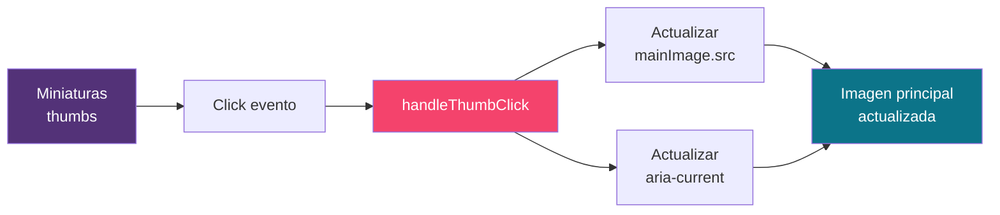

**Uso**:

```html
<plt-product-gallery>
  <div class="plt-product-detail__gallery-main">
    
  </div>
  <div class="plt-product-detail__thumbs">
    <button class="plt-product-detail__thumb" aria-current="true">
      
    </button>
    <button class="plt-product-detail__thumb">
      
    </button>
  </div>
</plt-product-gallery>
```

### Utilidades de Formato de Dinero

Conjunto de funciones para formatear precios de manera consistente.

**Interface Money**:

```typescript
interface Money {
  amount: string;
  currencyCode: string;
}
```

**Funciones**:

1. **formatMoney**: Formatea un objeto Money usando Intl.NumberFormat
2. **formatPriceRange**: Formatea un rango de precios (min – max)
3. **formatPriceDisplay**: Formatea precio con precio comparativo opcional

**Flujo de Formato**:

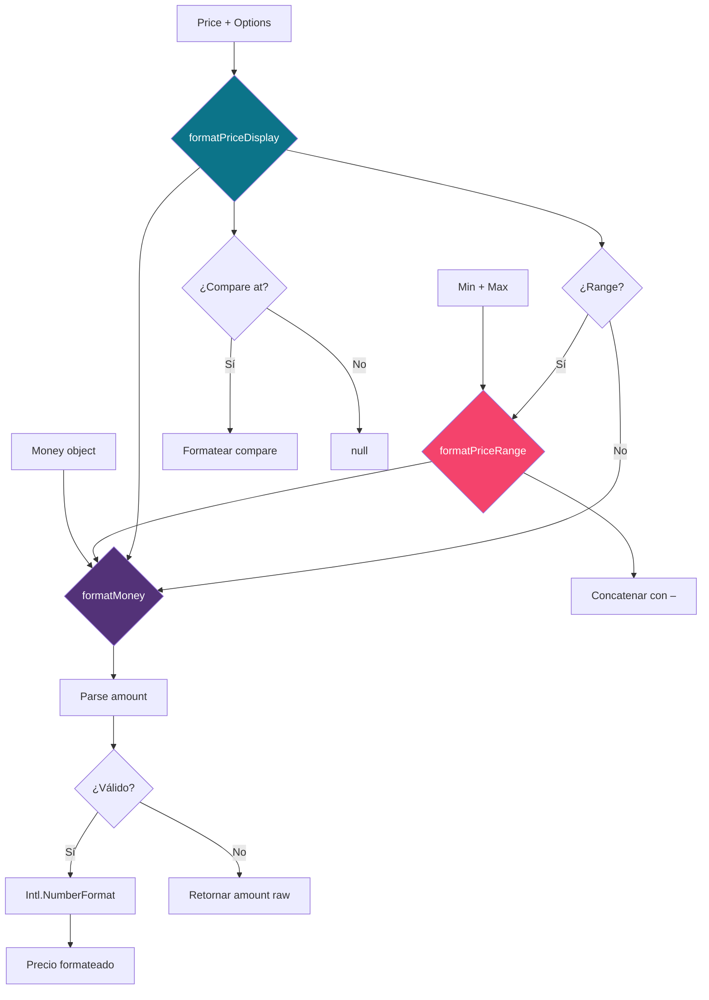

**Ejemplo de uso**:

```typescript
const price = { amount: "48.00", currencyCode: "USD" };
const compareAt = { amount: "62.00", currencyCode: "USD" };

const { display, compareDisplay } = formatPriceDisplay("en-US", price, {
  compareAtPrice: compareAt
});
// display: "$48.00"
// compareDisplay: "$62.00"
```

## Integración con Shopify CDN

### Optimización de Imágenes

El módulo `src/shopify/cdn-image.ts` proporciona utilidades para optimizar imágenes servidas desde Shopify CDN.

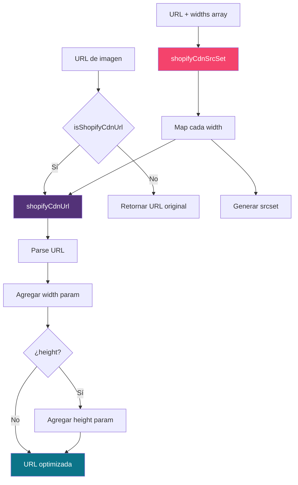

### Presets de Layout

Anchos predefinidos para diferentes contextos:

```typescript
const SHOPIFY_CDN_WIDTHS = {
  card: [200, 400, 600, 800],
  collection: [300, 600, 900],
  gallery: [400, 800, 1200, 1600],
};

const SHOPIFY_CDN_SIZES = {
  card: "(min-width: 1024px) 25vw, (min-width: 640px) 33vw, 50vw",
  collection: "(min-width: 1024px) 33vw, (min-width: 640px) 50vw, 100vw",
  gallery: "(min-width: 1024px) 50vw, 100vw",
};
```

**Ejemplo de uso**:

```typescript
const imageUrl = "https://cdn.shopify.com/s/files/1/0001/product.jpg";

// URL con ancho específico
const optimized = shopifyCdnUrl(imageUrl, { width: 800 });
// https://cdn.shopify.com/s/files/1/0001/product.jpg?width=800

// Srcset para imagen responsiva
const srcset = shopifyCdnSrcSet(imageUrl, SHOPIFY_CDN_WIDTHS.card);
// "...?width=200 200w, ...?width=400 400w, ..."
```

## Contratos y Renderizadores

### Arquitectura de Contratos

El sistema define **contratos visuales** que garantizan anatomía equivalente entre plataformas.

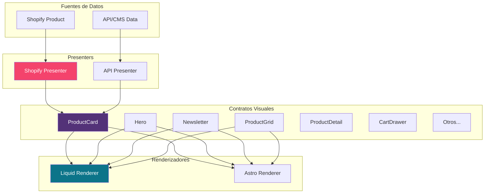

### Flujo de Normalización

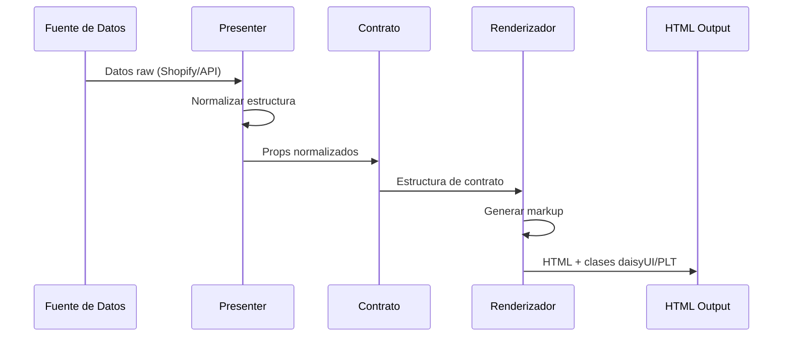

### Renderizadores Disponibles

**Liquid** (`renderers/liquid/*`):
- Para temas Shopify
- Acceso directo a objetos Shopify
- Filtros Liquid nativos

**Astro** (`renderers/astro/*`):
- Para headless/CMS
- Componentes tipados
- Props validados en build time

Ambos conjuntos emiten:
- ✅ Anatomía daisyUI equivalente
- ✅ Mismas clases de composición PLT
- ✅ Mismas clases `theme-*`

## Sistema de Preview de Islands

### Arquitectura de Islands

El archivo `docs/javascripts/plt-island-preview.js` implementa un sistema de preview para componentes PLT usando arquitectura de islands.

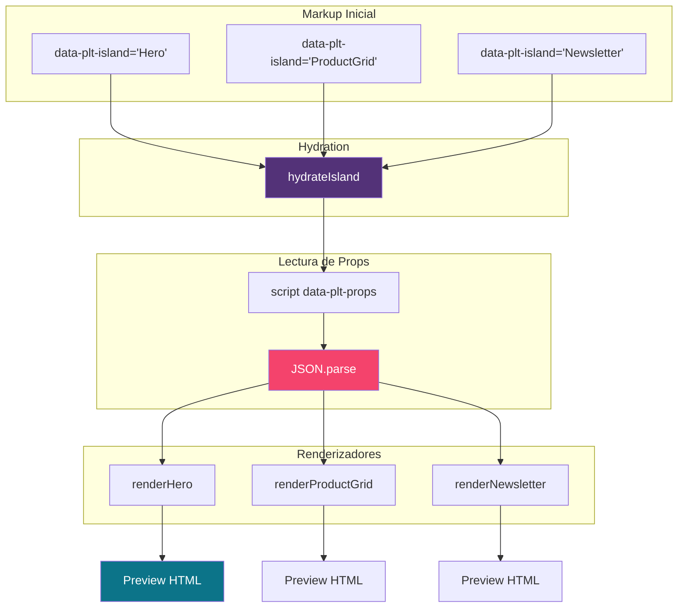

### Flujo de Hydration

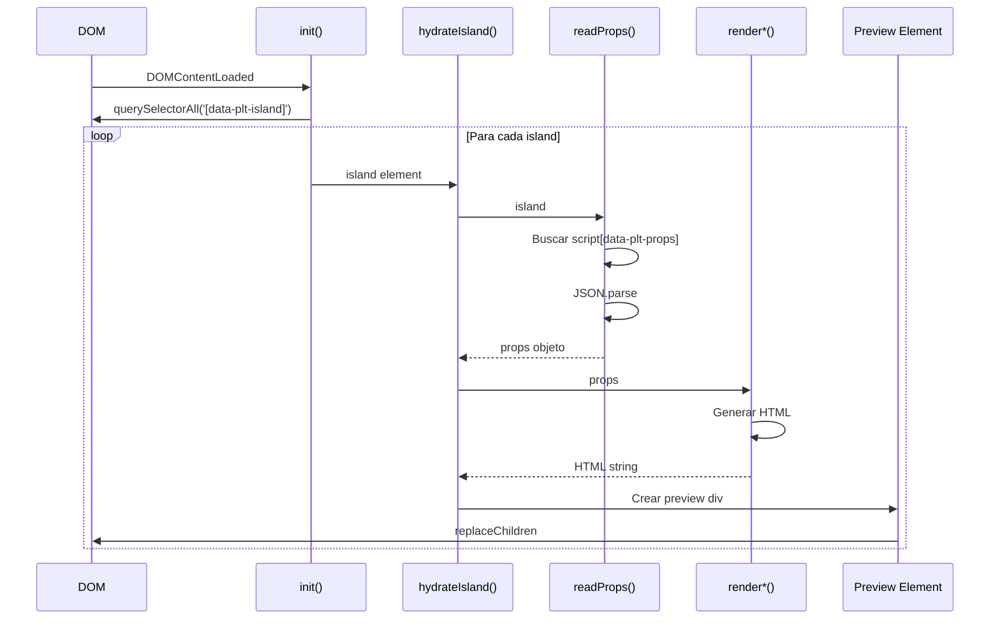

### Componentes de Preview

**Hero**:
```javascript
renderHero(props)
// props: { heading, body, primaryLabel, primaryUrl, secondaryLabel, secondaryUrl }
// output: <section class="d-hero plt-hero">...</section>
```

**ProductGrid**:
```javascript
renderProductGrid(props)
// props: { title, products: ['handle-1', 'handle-2', ...] }
// output: <section class="plt-section"><div class="plt-product-grid">...</div></section>
```

**Newsletter**:
```javascript
renderNewsletter(props)
// props: { heading, body, placeholder, buttonLabel }
// output: <section class="plt-newsletter">...</section>
```

### Datos Mock

El sistema incluye productos mock para previews:

```javascript
const MOCK_PRODUCTS = {
  "product-handle-1": {
    title: "Velvet Pulse",
    price: "$48.00",
    vendor: "PLT Essentials",
    badge: "New",
  },
  // ...
};
```

## Verificación y Testing

### Sistema de Verificación

El paquete incluye múltiples niveles de verificación automatizada:

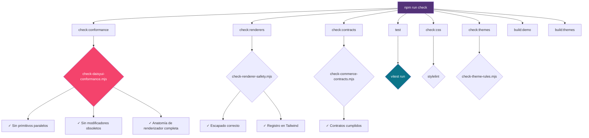

### Verificaciones de Conformidad

**check-daisyui-conformance.mjs**:
- ❌ Rechaza primitivos paralelos PLT (`plt-button`, `plt-card`, etc.)
- ❌ Rechaza modificadores obsoletos de daisyUI v5
- ✅ Valida anatomía completa de renderizadores

**check-renderer-safety.mjs**:
- ✅ Verifica escapado de HTML en renderizadores
- ✅ Confirma registro de fuentes Tailwind

**check-commerce-contracts.mjs**:
- ✅ Valida que los renderizadores cumplen contratos definidos

**check-theme-rules.mjs**:
- ✅ Verifica consistencia de reglas en temas

### Testing con Vitest

Configuración en `vitest.config.ts`:

```typescript
import { defineConfig } from "vitest/config";

export default defineConfig({
  test: {
    environment: "jsdom",
  },
});
```

**Tests de componentes**:
- `src/commerce/__tests__/gallery.test.ts`
- `src/commerce/__tests__/quick-view.test.ts`
- `src/commerce/format-money.test.ts`
- `src/shopify/cdn-image.test.ts`

### Flujo de CI

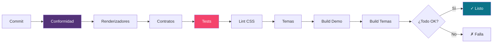

## Instalación y Uso

### Instalación

```bash
npm install @playlovetoys/design-system
```

### Dependencias Peer

- **daisyUI**: `>=5.7.8 <6`
- **Tailwind CSS**: `>=4 <5`

La versión mínima de daisyUI (5.7.8) evita problemas conocidos con prefijos corregidos durante la serie 5.7.

### Importación Base

```css
@import "tailwindcss";
@import "@playlovetoys/design-system";
```

Esto configura automáticamente:
- daisyUI con tema `brand` PLT
- Prefijo `d-` para componentes daisyUI
- Tokens y extensiones visuales PLT

### Importaciones Modulares

```css
/* Solo tokens */
@import "@playlovetoys/design-system/tokens";

/* Tipografía */
@import "@playlovetoys/design-system/typography";

/* Geometría */
@import "@playlovetoys/design-system/geometry";

/* Primitivos */
@import "@playlovetoys/design-system/primitives";

/* Patrones */
@import "@playlovetoys/design-system/patterns";

/* Adaptador Shopify */
@import "@playlovetoys/design-system/shopify";

/* Adaptador Astro */
@import "@playlovetoys/design-system/astro";

/* Tema específico */
@import "@playlovetoys/design-system/themes/nocturne.css";
```

### Uso en JavaScript/TypeScript

```typescript
// Utilidades de formato de dinero
import { formatMoney, formatPriceDisplay } from '@playlovetoys/design-system/commerce/format-money';

// Utilidades Shopify CDN
import { 
  shopifyCdnUrl, 
  shopifyCdnSrcSet,
  SHOPIFY_CDN_WIDTHS 
} from '@playlovetoys/design-system/shopify/cdn-image';

// Custom elements (se auto-registran)
import '@playlovetoys/design-system/commerce/quick-view';
import '@playlovetoys/design-system/commerce/gallery';
```

### Uso de Renderizadores

**Liquid (Shopify)**:

```liquid

```

**Astro**:

```astro
---
import ProductCard from '@playlovetoys/design-system/renderers/astro/ProductCard.astro';
---

<ProductCard
  title={product.title}
  price={product.price}
  image={product.image}
  url={product.url}
/>
```

## Dirección Visual

### Lenguaje Neo-Brutalista Suave

El sistema implementa un lenguaje visual de **comercio editorial neo-brutalista suave**:

- **Limpio**: Superficies off-white, espaciado generoso
- **Audaz**: Tipografía display uppercase
- **Juguetón**: Colores vibrantes, interacciones divertidas
- **Alto contraste**: Bordes visibles, sombras duras

### Principios Visuales

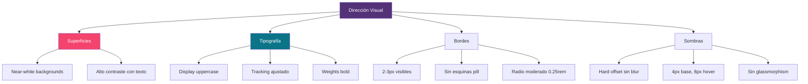

### Elementos Prohibidos

- ❌ Glassmorphism (fondos con blur)
- ❌ Gradientes suaves por defecto
- ❌ Bordes pill-shaped en UI base
- ❌ Sombras con blur

### Elementos Recomendados

- ✅ Bordes sólidos 2-3px
- ✅ Sombras hard offset
- ✅ Superficies flat de color sólido
- ✅ Tipografía uppercase en titulares
- ✅ Contraste visual fuerte

## Extensibilidad

### Creación de Nuevos Temas

1. **Definir tokens** en archivo CSS:

```css
/* themes/mi-tema.css */
@layer theme {
  [data-theme="mi-tema"] {
    /* Mapear a variables daisyUI */
    --p: 220 100% 50%;
    --s: 340 100% 50%;
    --a: 180 100% 50%;
    /* ... */
  }
}
```

2. **Ejecutar verificación**:

```bash
npm run check:themes
```

3. **Compilar**:

```bash
npm run build:themes
```

### Creación de Nuevos Patrones

1. **Usar primitivos daisyUI** como base
2. **Añadir clase `plt-*`** para composición
3. **Extender con `theme-*`** para marca
4. **Documentar contrato** en `contracts/components.md`
5. **Crear renderizadores** en Liquid y Astro
6. **Añadir tests** en `src/__tests__/`

### Ejemplo de Nuevo Patrón

```css
/* src/patterns.css */
.plt-feature-card {
  /* Composición usando primitivos daisyUI */
  @apply d-card bg-base-100;
}

.plt-feature-card__icon {
  @apply theme-bordered theme-elevated;
  /* Estilos específicos */
}
```

## Roadmap y Evolución

### Dependencias de Framework

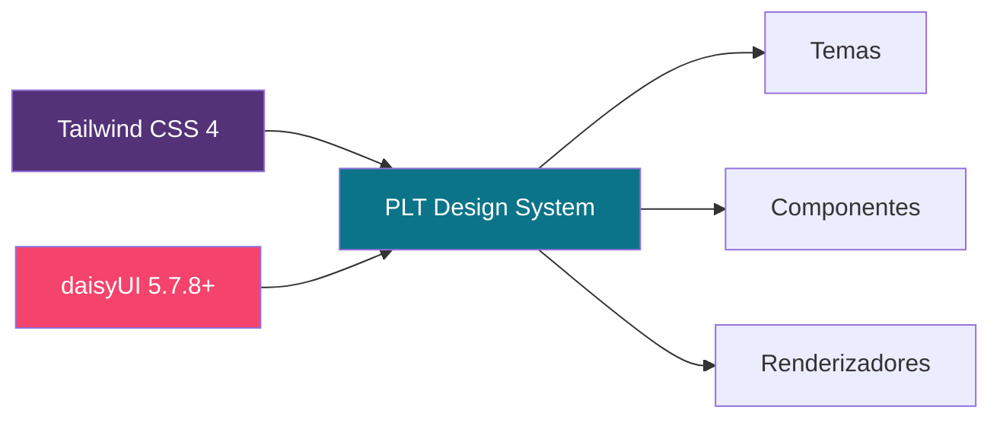

### Compatibilidad

- **Tailwind CSS**: `>=4 <5` (v4.x)
- **daisyUI**: `>=5.7.8 <6` (v5.7.8+)
- **Node.js**: Compatible con entornos modernos
- **Navegadores**: Últimas versiones evergreen

### Límites del Sistema

**Dentro del alcance**:
- ✅ Tokens de diseño visual
- ✅ Componentes UI reutilizables
- ✅ Temas de marca
- ✅ Renderizadores multiplataforma
- ✅ Utilidades de commerce

**Fuera del alcance**:
- ❌ Lógica de negocio Shopify
- ❌ Gestión de estado de carrito
- ❌ Enrutamiento de aplicación
- ❌ Esquemas CMS/editoriales
- ❌ Ciclo de vida de framework

## Referencias

### Documentación Interna

- `DESIGN.md`: Filosofía y principios de diseño
- `docs/primitives.md`: Primitivos visuales
- `docs/patterns.md`: Patrones compuestos
- `docs/renderers.md`: Sistema de renderizadores
- `docs/adapters.md`: Adaptadores de plataforma
- `docs/themes.md`: Sistema de temas
- `docs/daisyui-conformance.md`: Reglas de conformidad
- `contracts/components.md`: Contratos de componentes

### Dependencias Externas

- [Tailwind CSS v4](https://tailwindcss.com/): Framework de utilidades
- [daisyUI v5](https://daisyui.com/): Biblioteca de componentes
- [Vitest](https://vitest.dev/): Framework de testing

### Estructura del Paquete

**Exports principales** (`package.json`):

```json
{
  ".": "./src/index.css",
  "./tokens": "./src/tokens.css",
  "./typography": "./src/typography.css",
  "./geometry": "./src/geometry.css",
  "./primitives": "./src/primitives.css",
  "./patterns": "./src/patterns.css",
  "./shopify": "./adapters/shopify.css",
  "./astro": "./adapters/astro.css",
  "./renderers/liquid/*": "./renderers/liquid/*",
  "./renderers/astro/*": "./renderers/astro/*",
  "./themes/*": "./themes/*.css"
}
```

### Scripts de Desarrollo

```bash
# Build demo
npm run build:demo

# Verificar conformidad daisyUI
npm run check:conformance

# Verificar seguridad de renderizadores
npm run check:renderers

# Verificar contratos de commerce
npm run check:contracts

# Ejecutar tests
npm run test

# Lint CSS
npm run check:css

# Verificar reglas de temas
npm run check:themes

# Build temas
npm run build:themes

# Ejecutar todo
npm run check
```

## Diagrama de Flujo Completo

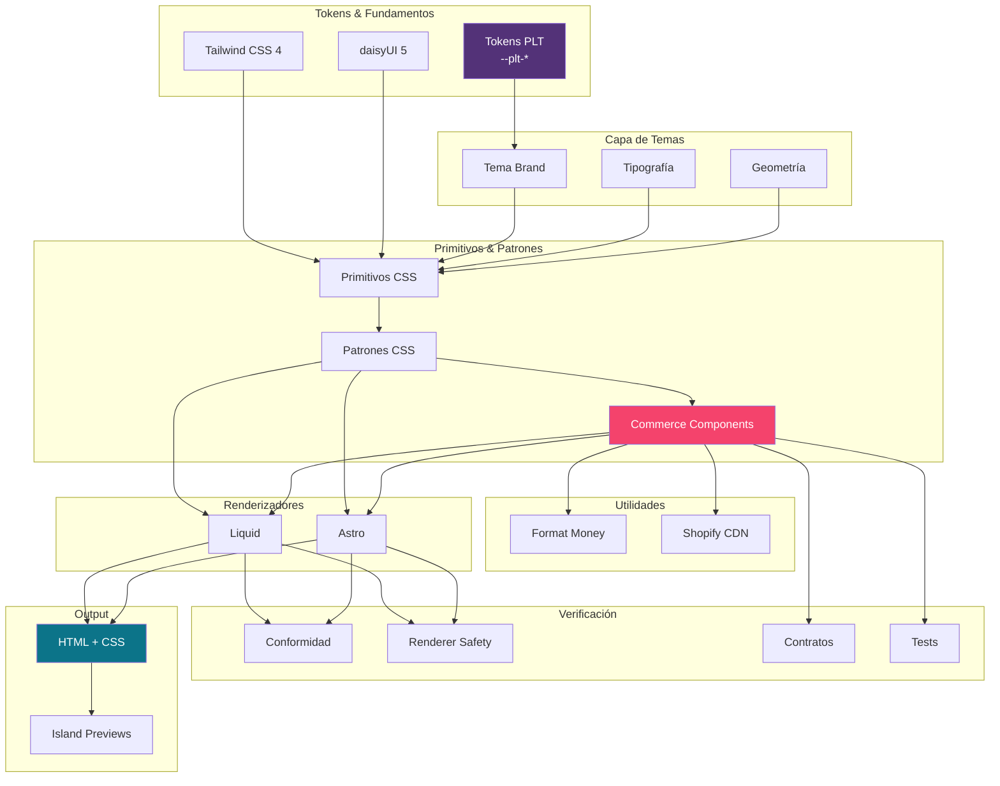
