# Sistema de Diseño PLT

## Introducción

El **PLT Design System** (`@playlovetoys/design-system`) es la capa de componentes visuales y fundamentos de diseño reutilizables para Play, love & Toys. Construido explícitamente sobre **daisyUI 5** y **Tailwind CSS 4**, proporciona un sistema cohesivo de tokens de diseño, tipografía, geometría, patrones compositivos y renderizadores multiplataforma para crear experiencias de comercio editorial coherentes.

### Propósito

Este paquete posee exclusivamente la capa visual y de componentes:

- Tokens de diseño PLT (`--plt-*`)
- Sistema de tipografía y geometría
- Tema `brand` de daisyUI
- Extensiones visuales PLT (`theme-bordered`, `theme-elevated`, etc.)
- Patrones compositivos específicos de PLT
- Renderizadores normalizados para Liquid y Astro

**No incluye**: esquemas editoriales, lógica CMS, comportamiento de negocio Shopify, enrutamiento, estado del carrito ni ciclo de vida de aplicaciones.

### Dirección Visual

Lenguaje de comercio editorial con estética neo-brutalista suave: limpio, audaz, lúdico y de alto contraste. Utiliza superficies casi blancas, tipografía display en mayúsculas, bordes visibles de 2-3px y sombras duras con desplazamiento sin desenfoque.

## Arquitectura

### Principio daisyUI-First

El sistema sigue un **invariante daisyUI-first**: cada componente con un equivalente en daisyUI debe usar la clase oficial prefijada como base. No se mantiene una biblioteca primitiva paralela.

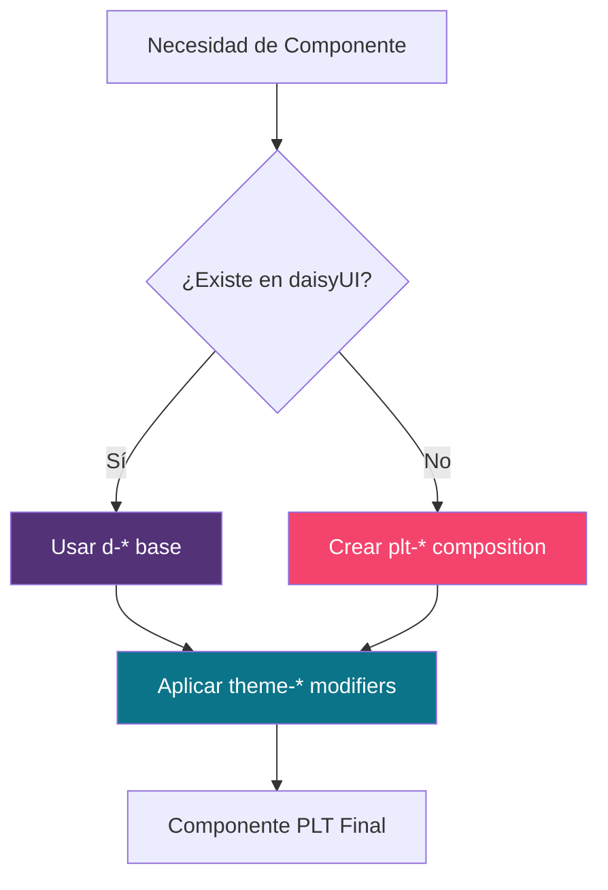

### Capas de Diseño

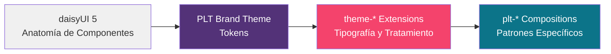

**Fuente de verdad**: Las propiedades personalizadas `--plt-*` son autoritativas para las decisiones de marca PLT. `src/daisyui-theme.css` las mapea a las variables del tema daisyUI.

### Arquitectura de Archivos

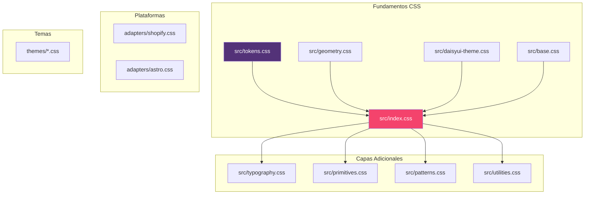

## Componentes Principales

### 1. Sistema de Tokens

Los tokens de diseño (`--plt-*`) son la base del sistema visual.

#### Tokens de Color

```css
/* Colores Principales */
--plt-color-primary: #533278
--plt-color-secondary: #F4436C
--plt-color-accent: #0C7489
--plt-color-base: #FAF7F2
--plt-color-base-content: oklch(37% 0.044 257.287)
```

#### Tokens de Tipografía

```css
/* Familias de Fuentes */
--plt-font-display: Fjalla One
--plt-font-body: Atkinson Hyperlegible
--plt-font-accent: Space Grotesk
```

#### Tokens de Geometría

```css
/* Radios y Bordes */
--plt-radius-field: 0.25rem
--plt-border-width: 2px
--plt-section-border-width: 3px

/* Sombras Duras */
--plt-shadow-offset: 4px
--plt-shadow-hover-offset: 8px
--plt-shadow-active-offset: 2px
```

### 2. Sistema de Tipografía

Utilidades de marca bajo el namespace `theme-*`:

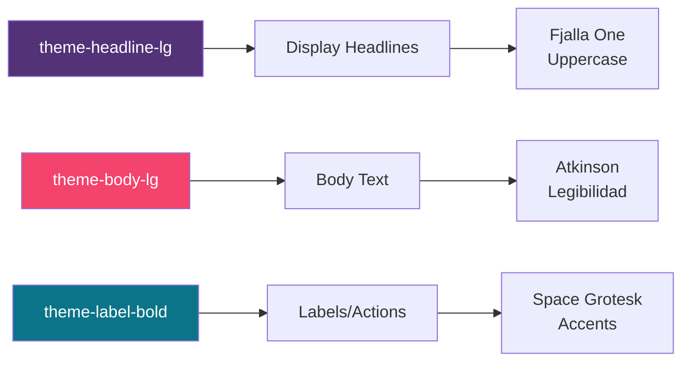

### 3. Patrones Compositivos

Componentes PLT específicos que no tienen equivalente directo en daisyUI:

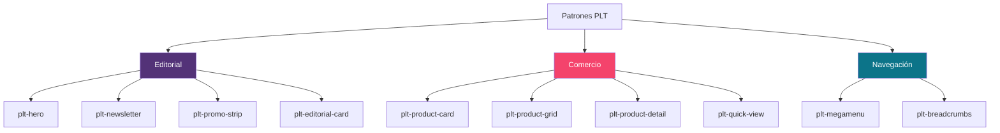

### 4. Utilidades de Comercio

#### Formateo de Moneda (`format-money.ts`)

```typescript
interface Money {
  amount: string;
  currencyCode: string;
}

// Formatea moneda con Intl.NumberFormat
formatMoney(money: Money, locale: string): string

// Formatea rango de precios
formatPriceRange(min: Money, max: Money, locale: string): string

// Formatea precio con precio comparativo
formatPriceDisplay(locale: string, price: Money, options?: {
  compareAtPrice?: Money | null;
  minPrice?: Money;
  maxPrice?: Money;
}): { display: string; compareDisplay: string | null }
```

#### CDN de Shopify (`cdn-image.ts`)

```typescript
// Presets de ancho para imágenes responsivas
SHOPIFY_CDN_WIDTHS = {
  card: [200, 400, 600, 800],
  collection: [300, 600, 900],
  gallery: [400, 800, 1200, 1600]
}

// Genera URL de CDN con parámetros
shopifyCdnUrl(url: string, options: { width: number; height?: number }): string

// Genera atributo srcset
shopifyCdnSrcSet(url: string, widths: readonly number[]): string

// Verifica si es URL de CDN Shopify
isShopifyCdnUrl(url: string | undefined): boolean
```

### 5. Web Components

#### ProductQuickView (`quick-view.js`)

Custom element para vista rápida de productos en modal.

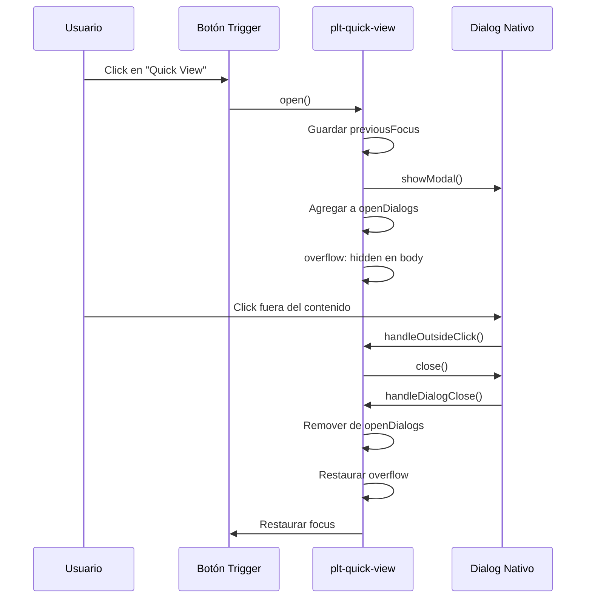

**Características**:
- Gestión automática de múltiples diálogos abiertos
- Control de overflow del body
- Restauración de foco después del cierre
- Click fuera para cerrar
- Soporte nativo de `<dialog>`

#### ProductGallery (`gallery.js`)

Custom element para galería de imágenes de producto con miniaturas.

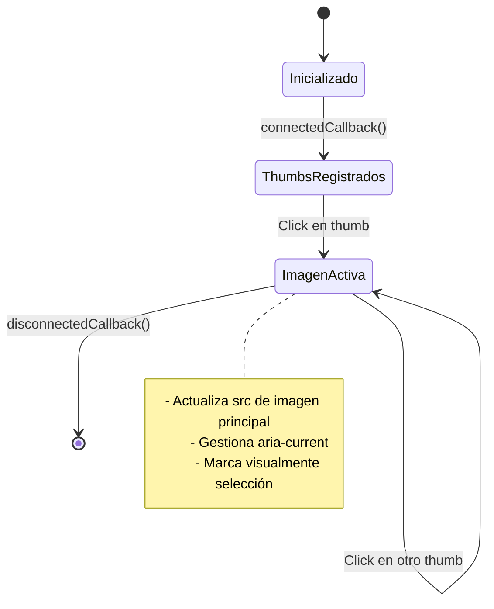

### 6. Sistema de Renderizadores

Renderizadores equivalentes multiplataforma que emiten la misma anatomía daisyUI.

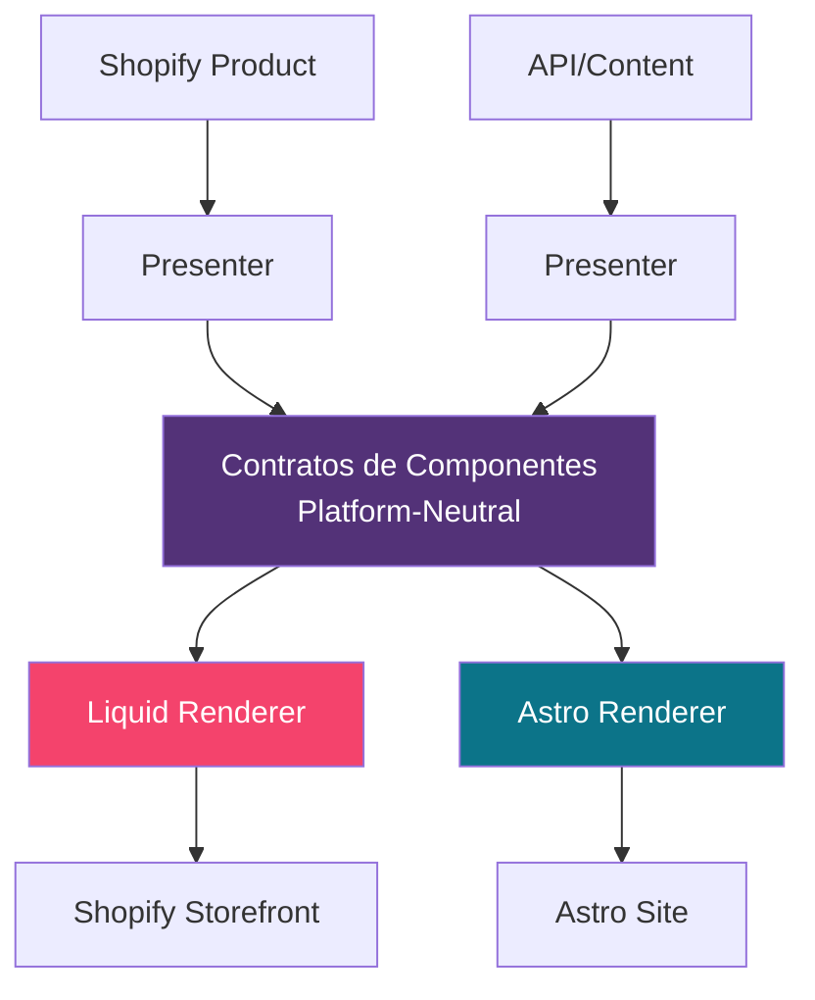

**Flujo de datos**:
```
Platform Object → Presenter → Contract → Renderer → daisyUI Markup
```

**Ejemplos de contratos**:

| Componente | Inputs Requeridos | Inputs Opcionales |
|------------|-------------------|-------------------|
| ProductCard | `title`, `url`, `price` | `image_url`, `vendor`, `badge`, `compare_at_price` |
| Hero | `heading` | `body`, `image_url`, `primary_label`, `primary_url` |
| Newsletter | `heading` | `body`, `form_action`, `input_placeholder` |
| FilterBar | `filters` (array) | `action`, `method`, `submit_label` |

## Flujos de Datos

### Flujo de Renderizado de Producto

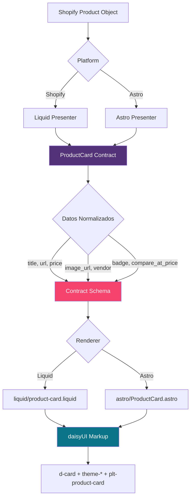

### Flujo de Procesamiento de Temas

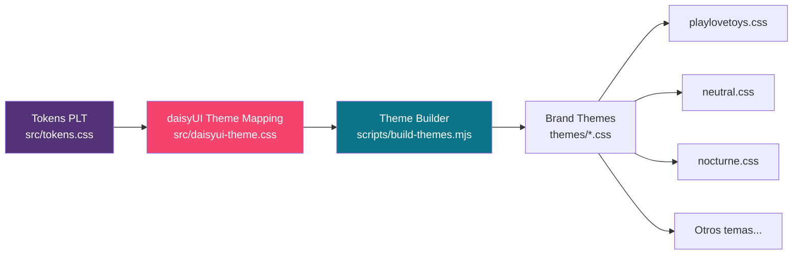

### Flujo de Verificación y Build

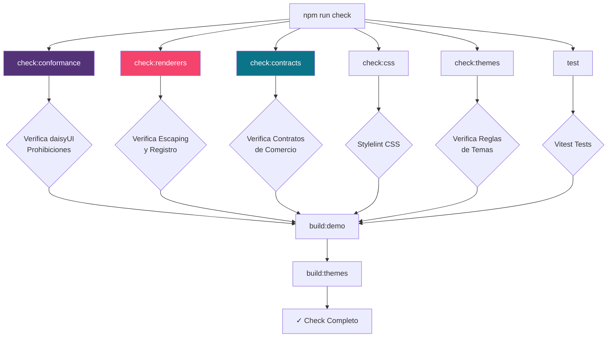

## Integración con Otras Plataformas

### Shopify

**Adaptador**: `adapters/shopify.css`

Proporciona ajustes específicos para la integración con temas Shopify:
- Normalización de clases Shopify
- Hooks para secciones y bloques
- Integración con el sistema de assets de Shopify

**Renderizadores Liquid**: `renderers/liquid/*.liquid`

Plantillas Liquid que implementan los contratos de componentes para Shopify.

### Astro

**Adaptador**: `adapters/astro.css`

Ajustes específicos para proyectos Astro.

**Componentes Astro**: `renderers/astro/*.astro`

Componentes Astro que implementan los mismos contratos que los renderizadores Liquid.

**Paquete de integración**: `@playlovetoys/astro`

Proporciona `BlockRenderer.astro` para renderizar bloques editoriales.

## Contratos de Componentes

Los contratos definen inputs platform-neutral para los renderizadores visuales. Excluyen intencionalmente objetos Shopify, colecciones de contenido Astro y estado de runtime.

### Contratos Principales

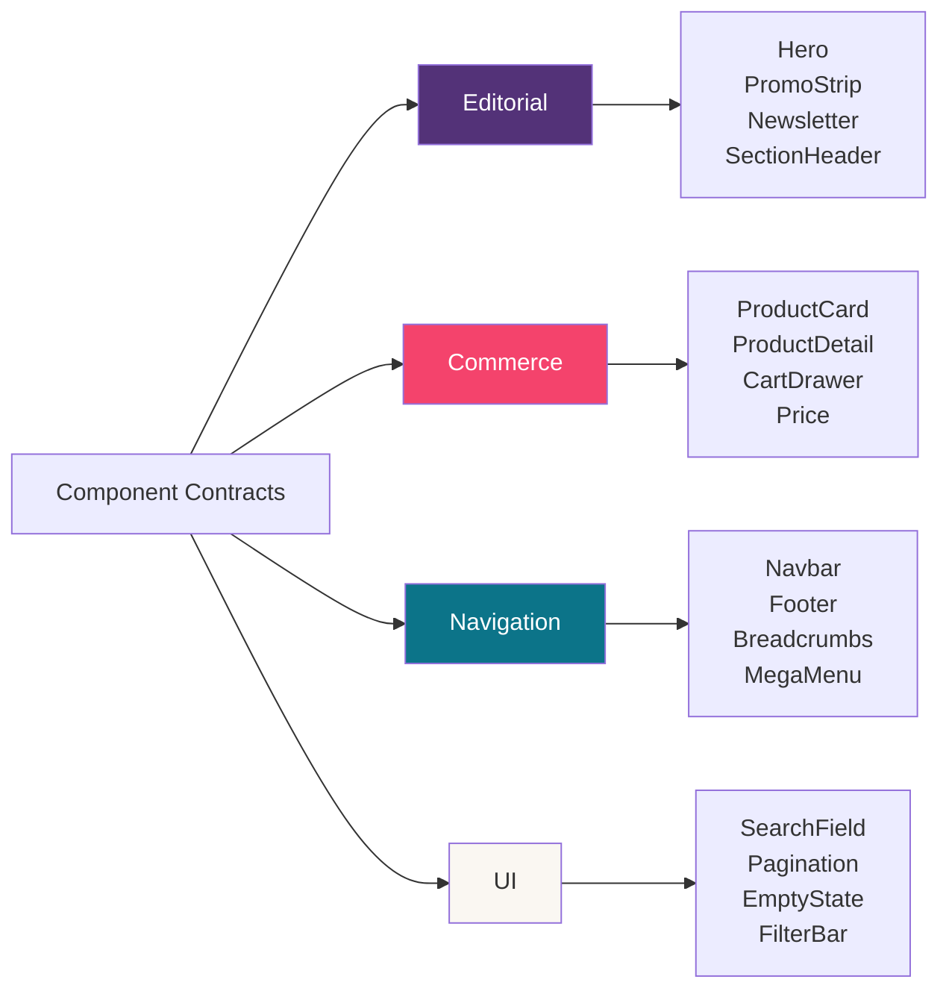

### Ejemplo: ProductCard Contract

```typescript
interface ProductCardContract {
  // Requerido
  title: string;
  url: string;
  price: string; // Ya formateado
  
  // Opcional
  image_url?: string;
  image_alt?: string;
  vendor?: string;
  compare_at_price?: string; // Ya formateado
  badge?: string;
  action_label?: string;
  action_url?: string;
}
```

**Fuera del contrato**:
- Selección de imagen secundaria
- Resolución de variantes
- Formateo de moneda
- Reseñas
- Swatches
- Comportamiento quick-add

### Ejemplo: Hero Contract

```typescript
interface HeroContract {
  // Requerido
  heading: string;
  
  // Opcional
  eyebrow?: string;
  body?: string;
  image_url?: string;
  image_alt?: string;
  primary_label?: string;
  primary_url?: string;
  secondary_label?: string;
  secondary_url?: string;
}
```

## Scripts de Desarrollo

### Verificación de Conformidad

```bash
npm run check:conformance
```

**Propósito**: Verifica que no existan:
- Primitivos PLT paralelos prohibidos (`plt-button`, `plt-card`, etc.)
- Modificadores daisyUI obsoletos (`d-input-bordered`, etc.)
- Anatomía incompleta de renderizadores

**Implementación**: `scripts/check-daisyui-conformance.mjs`

### Verificación de Renderizadores

```bash
npm run check:renderers
```

**Propósito**: Verifica:
- Escaping correcto de valores dinámicos
- Registro en fuentes de Tailwind
- Sintaxis válida de plantillas

**Implementación**: `scripts/check-renderer-safety.mjs`

### Verificación de Contratos

```bash
npm run check:contracts
```

**Propósito**: Valida que los contratos de comercio estén correctamente implementados.

**Implementación**: `scripts/check-commerce-contracts.mjs`

### Build de Temas

```bash
npm run build:themes
```

**Propósito**: Genera archivos CSS de temas a partir de tokens PLT.

**Implementación**: `scripts/build-themes.mjs`

Genera temas en `themes/`:
- `playlovetoys.css` - Tema principal de marca
- `neutral.css` - Tema neutro
- `nocturne.css` - Tema oscuro
- `capricho.css`, `playdoh.css`, `konstrukt.css`, etc. - Variantes de marca

### Build de Demo

```bash
npm run build:demo
```

**Propósito**: Compila el catálogo de demostración con Tailwind CSS 4 + daisyUI 5.

Detecta:
- Integración inválida de plugins/temas
- Errores de configuración de Tailwind
- Problemas de compilación CSS

## Testing

### Framework de Pruebas

**Vitest** con entorno jsdom para componentes web.

**Configuración**: `vitest.config.ts`

```typescript
export default defineConfig({
  test: {
    environment: "jsdom",
  },
});
```

### Pruebas de Utilidades

**Formateo de Moneda**: `src/commerce/format-money.test.ts`

Verifica:
- Formateo correcto con diferentes locales
- Manejo de rangos de precios
- Formateo de precio comparativo
- Manejo de valores inválidos

**CDN de Shopify**: `src/shopify/cdn-image.test.ts`

Verifica:
- Detección de URLs de CDN Shopify
- Generación correcta de parámetros
- Generación de srcset
- Manejo de URLs no-CDN

### Pruebas de Web Components

**ProductQuickView**: `src/commerce/__tests__/quick-view.test.ts`

Verifica:
- Apertura/cierre de diálogo
- Gestión de múltiples diálogos
- Control de overflow del body
- Restauración de foco
- Click fuera para cerrar

**ProductGallery**: `src/commerce/__tests__/gallery.test.ts`

Verifica:
- Cambio de imagen principal
- Gestión de aria-current
- Inicialización correcta
- Limpieza de event listeners

## Integración con CI/CD

### GitHub Actions

#### Conformidad daisyUI

**Workflow**: `.github/workflows/daisyui-conformance.yml`

```yaml
on:
  pull_request:
  push:
    branches: [main]

jobs:
  conformance:
    - npm install
    - npm run check
```

Ejecuta la suite completa de verificación en PRs y pushes a `main`.

#### Documentación Zensical

**Workflow**: `.github/workflows/zensical-docs.yml`

```yaml
jobs:
  build-docs:
    - pip install -r requirements.txt
    - npm ci
    - npm run docs:build:all
```

Construye el sitio de documentación con Zensical.

#### Deploy a Cloudflare Pages

**Workflow**: `.github/workflows/deploy-docs.yml`

```yaml
jobs:
  deploy:
    - npm run docs:build:all
    - cloudflare/wrangler-action@v3
      command: pages deploy site --project-name=plt-docs
```

Despliega automáticamente la documentación a Cloudflare Pages en cada push a `main`.

## Instalación y Uso

### Instalación

```bash
npm install @playlovetoys/design-system
```

**Peer dependencies**:
- `daisyui` >= 5.7.8 < 6
- `tailwindcss` >= 4 < 5

### Import Básico

```css
@import "tailwindcss";
@import "@playlovetoys/design-system";
```

### Import Selectivo

```css
/* Solo tokens */
@import "@playlovetoys/design-system/tokens";

/* Tipografía */
@import "@playlovetoys/design-system/typography";

/* Patrones */
@import "@playlovetoys/design-system/patterns";

/* Tema específico */
@import "@playlovetoys/design-system/themes/nocturne.css";
```

### Uso de Renderizadores

#### Liquid (Shopify)

```liquid

```

#### Astro

```astro
---
import ProductCard from '@playlovetoys/design-system/renderers/astro/ProductCard.astro';
import { formatMoney } from '@playlovetoys/design-system/src/commerce/format-money.ts';
---

<ProductCard
  title={product.title}
  url={product.url}
  price={formatMoney(product.price, locale)}
  imageUrl={product.image}
  vendor={product.vendor}
/>
```

### Uso de Web Components

```html
<!-- Product Quick View -->
<plt-quick-view>
  <button data-quick-view-open class="d-btn d-btn-secondary">
    Vista Rápida
  </button>
  <dialog>
    <div>
      <button data-quick-view-close>✕</button>
      <!-- Contenido del producto -->
    </div>
  </dialog>
</plt-quick-view>

<!-- Product Gallery -->
<plt-product-gallery>
  <div class="plt-product-detail__gallery-main">
    
  </div>
  <div class="plt-product-detail__thumbs">
    <button class="plt-product-detail__thumb" aria-current="true">
      
    </button>
    <button class="plt-product-detail__thumb">
      
    </button>
  </div>
</plt-product-gallery>
```

## Mapeo de Componentes

### daisyUI → PLT

| Necesidad PLT | Base daisyUI | Extensiones PLT |
|---------------|--------------|-----------------|
| Botón / CTA | `d-btn` | `theme-bordered`, `theme-elevated`, `theme-label-bold` |
| Card | `d-card`, `d-card-body` | `theme-bordered`, `theme-elevated`, `plt-media-card` |
| Badge | `d-badge` | `theme-label-bold` |
| Input de texto | `d-input` | - |
| Select | `d-select` | - |
| Textarea | `d-textarea` | - |
| Divider | `d-divider` | - |
| Alert | `d-alert` | - |
| Hero | `d-hero`, `d-hero-content` | `plt-hero` |
| Breadcrumbs | `d-breadcrumbs` | - |
| Navbar | `d-navbar`, `d-menu` | - |
| Footer | `d-footer`, `d-menu` | - |
| Cart drawer | `d-drawer` | `plt-cart-drawer` |

### APIs Prohibidas

Las siguientes familias de clases **no deben** utilizarse (conflicto con daisyUI-first):

- `plt-button`, `plt-card`, `plt-badge`
- `plt-input`, `plt-select`, `plt-textarea`
- `plt-alert`, `plt-divider`, `plt-nav-link`
- `plt-headline-*`, `plt-body-*`, `plt-meta`
- `plt-bordered`, `plt-elevated`, `plt-sidebar-shadow`

**Alternativas correctas**:
- Anatomía de componente → `d-*` (daisyUI)
- Modificadores de marca/tipografía → `theme-*`
- Composiciones sin equivalente daisyUI → `plt-*`

## Exports del Paquete

```json
{
  ".": "./src/index.css",
  "./tokens": "./src/tokens.css",
  "./tokens/*": "./src/tokens/*",
  "./typography": "./src/typography.css",
  "./geometry": "./src/geometry.css",
  "./utilities": "./src/utilities.css",
  "./primitives": "./src/primitives.css",
  "./patterns": "./src/patterns.css",
  "./daisyui": "./src/daisyui-theme.css",
  "./shopify": "./adapters/shopify.css",
  "./astro": "./adapters/astro.css",
  "./contracts": "./contracts/components.md",
  "./renderers/liquid/*": "./renderers/liquid/*",
  "./renderers/astro/*": "./renderers/astro/*",
  "./base": "./src/base.css",
  "./themes/*": "./themes/*.css"
}
```

## Sistema de Documentación

### Zensical

El proyecto usa **Zensical** para generar documentación técnica.

**Configuración**: `zensical.toml`

```toml
[project]
site_name = "PlayLoveToys Design System"
docs_dir = "docs"
site_dir = "site"
dev_addr = "localhost:8000"

watch = [
  "packages/design-system",
  "packages/editorial",
  "packages/astro"
]
```

### Scripts de Documentación

```bash
# Servir documentación en desarrollo
npm run docs:serve

# Build de documentación
npm run docs:build

# Build completo (incluye verificaciones)
npm run docs:build:all
```

### Island Preview System

Sistema de vista previa para componentes "island" en la documentación.

**Implementación**: `docs/javascripts/plt-island-preview.js`

Componentes soportados:
- `Hero`
- `ProductGrid`
- `Newsletter`

```html
<div data-plt-island="Hero">
  <script data-plt-props type="application/json">
    {
      "heading": "Welcome",
      "body": "Description text",
      "primaryLabel": "Shop Now",
      "primaryUrl": "/shop"
    }
  </script>
</div>
```

El script hidrata automáticamente estos placeholders con previsualizaciones interactivas.

## Mejores Prácticas

### 1. Uso de daisyUI

✅ **Correcto**:
```html
<button class="d-btn d-btn-primary theme-bordered theme-elevated theme-label-bold">
  Shop now
</button>
```

❌ **Incorrecto**:
```html
<button class="plt-button plt-button-primary plt-bordered">
  Shop now
</button>
```

### 2. Tipografía de Marca

✅ **Correcto**:
```html
<h1 class="theme-headline-lg">Headline</h1>
<p class="theme-body-md">Body text</p>
<span class="theme-label-bold">Label</span>
```

❌ **Incorrecto**:
```html
<h1 class="plt-headline-lg">Headline</h1>
<p class="plt-body-md">Body text</p>
```

### 3. Composiciones PLT

✅ **Correcto** (no existe equivalente daisyUI):
```html
<article class="d-card plt-product-card theme-bordered theme-elevated">
  <div class="plt-media-card__media">...</div>
  <div class="d-card-body plt-media-card__body">
    <h3 class="d-card-title theme-headline-sm">...</h3>
  </div>
</article>
```

### 4. Contratos de Componentes

✅ **Correcto** (presenter normaliza datos):
```typescript
// presenter.ts
function toProductCard(shopifyProduct) {
  return {
    title: shopifyProduct.title,
    url: shopifyProduct.url,
    price: formatMoney(shopifyProduct.price, locale),
    imageUrl: shopifyProduct.featuredImage?.url,
    vendor: shopifyProduct.vendor
  };
}
```

❌ **Incorrecto** (pasa objeto de plataforma directamente):
```astro
<ProductCard product={shopifyProduct} />
```

### 5. Responsive Design

Usar container queries para componentes que necesitan adaptarse a su contenedor:

```css
.plt-product-card {
  container-type: inline-size;
  container-name: plt-product-card;
}

@container plt-product-card (max-width: 14rem) {
  .plt-media-card__actions {
    flex-direction: column;
  }
  
  .plt-media-card__actions .d-btn {
    width: 100%;
  }
}
```

## Troubleshooting

### Problema: Estilos daisyUI no se aplican

**Causa**: Orden de import incorrecto o configuración de daisyUI incorrecta.

**Solución**:
```css
/* Orden correcto */
@import "tailwindcss";
@import "@playlovetoys/design-system";
```

Verificar que daisyUI >= 5.7.8 esté instalado.

### Problema: Modificadores obsoletos

**Causa**: Uso de modificadores removidos en daisyUI 5.

**Solución**: Remover:
- `d-input-bordered` (bordered es default)
- `d-select-bordered` (bordered es default)
- `d-textarea-bordered` (bordered es default)
- `d-card-bordered` (usar `theme-bordered`)

### Problema: Verificación de conformidad falla

**Causa**: Uso de clases prohibidas o anatomía incorrecta.

**Solución**:
```bash
npm run check:conformance
```

Revisar el output para identificar violaciones específicas.

### Problema: Temas no se generan

**Causa**: Script de build-themes no ejecutado.

**Solución**:
```bash
npm run build:themes
```

## Contribución

### Workflow de Desarrollo

1. **Clonar repositorio**:
```bash
git clone <repo-url>
cd plt-design-system
```

2. **Instalar dependencias**:
```bash
npm install
```

3. **Desarrollo local**:
```bash
npm run docs:serve  # Documentación en localhost:8000
```

4. **Verificar cambios**:
```bash
npm run check  # Suite completa de verificación
```

5. **Ejecutar tests**:
```bash
npm test  # o npm run test
```

### Agregar Nuevo Componente

1. **Verificar que no exista equivalente daisyUI**
2. **Definir contrato** en `contracts/components.md`
3. **Implementar CSS** en `src/patterns.css`
4. **Crear renderizadores**:
   - `renderers/liquid/<component>.liquid`
   - `renderers/astro/<Component>.astro`
5. **Agregar tests** si incluye lógica JavaScript
6. **Documentar** en archivos de docs
7. **Ejecutar verificaciones**:
```bash
npm run check
```

### Agregar Nuevo Tema

1. **Definir tokens** en archivo de tema
2. **Extender** de tokens base PLT
3. **Registrar** en build script si es necesario
4. **Ejecutar**:
```bash
npm run build:themes
npm run check:themes
```

## Roadmap

### Implementado ✅

- ✅ Sistema de tokens PLT
- ✅ Tema brand daisyUI
- ✅ Tipografía y geometría
- ✅ Patrones compositivos principales
- ✅ Renderizadores Liquid y Astro
- ✅ Contratos de componentes
- ✅ Utilidades de comercio (money, CDN)
- ✅ Web components (QuickView, Gallery)
- ✅ Sistema de verificación automatizado
- ✅ CI/CD con GitHub Actions
- ✅ Documentación con Zensical

### En Progreso 🚧

- 🚧 Componentes de reseñas (ReviewCard, ReviewSummary)
- 🚧 MegaMenu completo
- 🚧 Componentes FAQ
- 🚧 Más variantes de temas

### Planificado 📋

- 📋 Sistema de design tokens exportable
- 📋 Storybook para catálogo visual
- 📋 Más utilidades de accesibilidad
- 📋 Optimizaciones de performance
- 📋 Documentación interactiva mejorada

## Referencias

### Documentación Interna

- `DESIGN.md` - Dirección visual y fundamentos
- `docs/daisyui-conformance.md` - Reglas de conformidad
- `docs/primitives.md` - Primitivos del sistema
- `docs/patterns.md` - Patrones compositivos
- `docs/renderers.md` - Guía de renderizadores
- `docs/adapters.md` - Adaptadores de plataforma
- `contracts/components.md` - Contratos de componentes

### Dependencias Externas

- [daisyUI](https://daisyui.com/) - Biblioteca de componentes UI
- [Tailwind CSS](https://tailwindcss.com/) - Framework CSS utility-first
- [Zensical](https://github.com/zensical/zensical) - Generador de documentación
- [Vitest](https://vitest.dev/) - Framework de testing

### Relacionado

- `@playlovetoys/editorial` - Esquemas editoriales y contratos de contenido
- `@playlovetoys/astro` - Integraciones para Astro (BlockRenderer)

## Licencia y Autoría

**Paquete**: `@playlovetoys/design-system` v0.7.0  
**Autor**: AA Digital Business  
**Privado**: Sí (uso interno)

---

**Última actualización**: 2026-10-10
