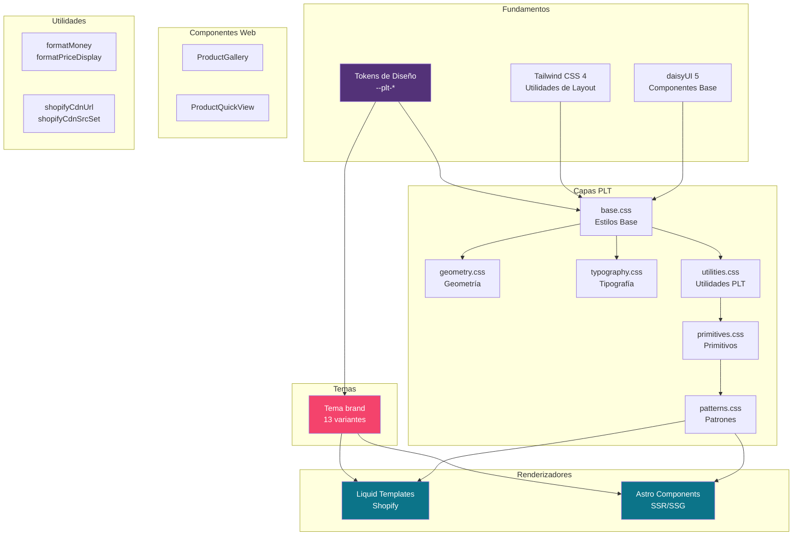
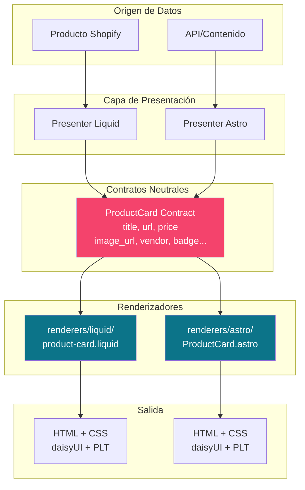
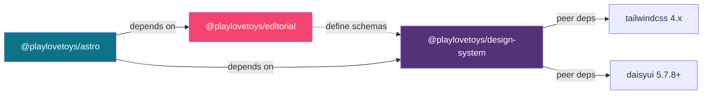
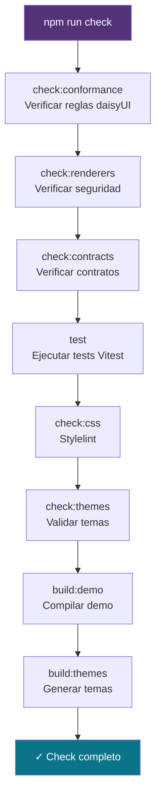
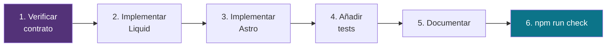
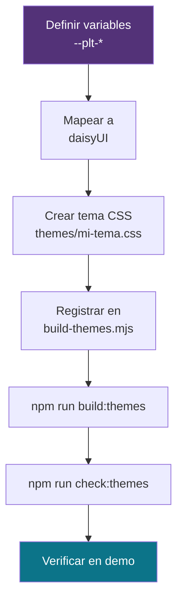

# Sistema de Diseño PLT

## Introducción

El **Sistema de Diseño PLT** (`@playlovetoys/design-system`) es una capa de componentes visuales portables, fundamentos de diseño y renderizadores multiplataforma para Play, love & Toys. Proporciona una arquitectura basada en **daisyUI 5** y **Tailwind CSS 4**, ofreciendo tokens de marca, componentes reutilizables y contratos neutrales de plataforma para Shopify (Liquid) y Astro.

**Características principales:**
- 🎨 Tokens de diseño PLT (`--plt-*`) como fuente única de verdad
- 🧱 Arquitectura "daisyUI-first" sin implementaciones paralelas
- 🎭 13 temas predefinidos con soporte de personalización
- 📦 Contratos de componentes neutrales de plataforma
- 🔄 Renderizadores equivalentes para Liquid y Astro
- 🛍️ Componentes web para comercio electrónico
- 🖼️ Utilidades para imágenes CDN de Shopify y formato de precios
- ✨ Lenguaje visual neo-brutalista suave: limpio, audaz, juguetón y de alto contraste

**Paquete:** `@playlovetoys/design-system` v0.7.0

**Política upstream:** los arreglos de UI compartida viven en este monorepo; ver [upstream-ui-policy.md](../upstream-ui-policy.md).

## Arquitectura

### Visión General del Sistema



### Arquitectura de Capas

El sistema sigue una arquitectura en capas estricta donde cada nivel construye sobre el anterior:


**Niveles:**

1. **Tokens** (`src/tokens/`): Variables CSS que definen la paleta de colores, espaciado, tipografía, radios, sombras, breakpoints y movimiento
2. **Geometría + Tipografía**: Sistemas fundamentales de medidas y texto
3. **Base + daisyUI**: Integración del tema PLT con daisyUI 5
4. **Utilidades**: Clases auxiliares con el prefijo `theme-*`
5. **Primitivos**: Componentes básicos reutilizables
6. **Patrones**: Composiciones PLT específicas usando `plt-*` para elementos que daisyUI no proporciona
7. **Renderizadores**: Implementaciones concretas en Liquid y Astro

### Flujo de Datos y Contratos



### Dependencias entre Módulos



**Referencias a otros módulos:**
- Ver [@playlovetoys/editorial](plt-editorial.md) para esquemas de páginas editoriales e islas de hidratación
- Ver [@playlovetoys/astro](plt-astro.md) para el renderizador de bloques Astro

## Componentes Principales

### 1. Tokens de Diseño

Los tokens son la **fuente única de verdad** para las decisiones de marca PLT, definidos como propiedades personalizadas CSS (`--plt-*`).

**Ubicación:** `src/tokens/`

**Archivos:**
- `colors.css` - Paleta de colores de marca
- `spacing.css` - Sistema de espaciado
- `typography.css` - Escalas y familias tipográficas
- `radius.css` - Radios de borde
- `shadows.css` - Sombras duras offset
- `breakpoints.css` - Puntos de quiebre responsive
- `motion.css` - Duraciones y easings de transición

**Colores fundamentales:**
```css
--plt-primary: #533278;      /* Púrpura */
--plt-secondary: #F4436C;    /* Rosa vibrante */
--plt-accent: #0C7489;       /* Turquesa */
--plt-base-surface: #FAF7F2; /* Superficie casi blanca */
--plt-base-content: oklch(37% 0.044 257.287); /* Texto oscuro */
```

**Uso:**
```css
.mi-componente {
  background-color: var(--plt-primary);
  border-radius: var(--plt-radius-field);
  box-shadow: var(--plt-shadow-offset) var(--plt-shadow-offset) 0 var(--plt-shadow-color);
}
```

### 2. Tipografía

**Sistema de tres familias:**

- **Display:** Fjalla One (titulares en mayúsculas, bold, tracking ajustado)
- **Body:** Atkinson Hyperlegible (lectura optimizada)
- **Accent/Labels:** Space Grotesk (etiquetas y énfasis)

**Clases tipográficas con prefijo `theme-*`:**

```html
<!-- Titulares -->
<h1 class="theme-headline-lg">Titular Grande</h1>
<h2 class="theme-headline-md">Titular Medio</h2>
<h3 class="theme-headline-sm">Titular Pequeño</h3>

<!-- Cuerpo -->
<p class="theme-body-lg">Cuerpo grande</p>
<p class="theme-body">Cuerpo normal</p>
<p class="theme-body-sm">Cuerpo pequeño</p>

<!-- Meta y etiquetas -->
<span class="theme-meta">Metadatos</span>
<span class="theme-label-bold">Etiqueta Bold</span>
```

**Ubicación:** `src/typography.css`

### 3. Geometría

Define el lenguaje visual neo-brutalista suave de PLT:

**Características:**
- Radio de campo/caja: `0.25rem`
- Borde de componente base: `2px`
- Borde de sección/énfasis PLT: `3px`
- Offset de sombra dura: `4px`
- Offset de sombra en hover: `8px`
- Offset de sombra activa: `2px`

**Clases de tratamiento visual:**

```html
<!-- Borde visible -->
<div class="theme-bordered">Contenido con borde</div>

<!-- Sombra dura offset -->
<div class="theme-elevated">Contenido elevado</div>

<!-- Ambos -->
<button class="d-btn d-btn-primary theme-bordered theme-elevated">
  Botón PLT
</button>
```

**Ubicación:** `src/geometry.css`

### 4. Utilidades

Clases auxiliares con prefijo `theme-*` que extienden la funcionalidad de daisyUI sin crear primitivos paralelos.

**Ubicación:** `src/utilities.css`

### 5. Primitivos

Componentes básicos que utilizan **exclusivamente** las clases oficiales de daisyUI con prefijo `d-`.

**Principio "daisyUI-first":**
> Nunca crear una implementación paralela para algo que daisyUI ya proporciona

**Mapeo de componentes:**

| Concepto | Clase daisyUI | PLT Extensions |
|----------|---------------|----------------|
| Botón | `d-btn` | `theme-bordered theme-elevated theme-label-bold` |
| Tarjeta | `d-card` | `theme-bordered theme-elevated` |
| Badge | `d-badge` | `theme-label-bold` |
| Input | `d-input` | - |
| Select | `d-select` | - |
| Textarea | `d-textarea` | - |
| Alert | `d-alert` | - |
| Divider | `d-divider` | - |
| Link | `d-link` | - |
| Hero | `d-hero` | - |
| Tabs | `d-tabs`, `d-tab` | - |
| Breadcrumbs | `d-breadcrumbs` | - |

**Ejemplo de uso correcto:**

```html
<button class="d-btn d-btn-primary theme-bordered theme-elevated theme-label-bold">
  Comprar ahora
</button>

<article class="d-card bg-base-100 theme-bordered theme-elevated">
  <div class="d-card-body">
    <h2 class="d-card-title theme-headline-sm">Título de Tarjeta</h2>
    <p class="theme-body">Descripción del contenido.</p>
    <div class="d-card-actions">
      <button class="d-btn d-btn-secondary d-btn-sm theme-bordered theme-elevated">
        Ver más
      </button>
    </div>
  </div>
</article>

<span class="d-badge d-badge-secondary theme-label-bold">Nuevo</span>
```

**Ubicación:** `src/primitives.css`

**⚠️ Prohibido:**
- Clases `plt-button`, `plt-card`, `plt-badge`, etc. (usar daisyUI)
- Modificadores obsoletos: `d-input-bordered`, `d-select-bordered`, `d-textarea-bordered`, `d-card-bordered`

### 6. Patrones

Composiciones PLT específicas usando el prefijo `plt-*` para elementos que daisyUI **no proporciona**.

**Patrones disponibles:**

- `plt-hero` - Hero con acciones y copy
- `plt-product-card` - Tarjeta de producto con foto, badge, precio y acción
- `plt-product-grid` - Grid responsive de productos
- `plt-media-card` - Tarjeta genérica con media
- `plt-newsletter` - Formulario de suscripción
- `plt-cart-lines` - Lista de líneas de carrito
- `plt-cart-line` - Línea individual de carrito
- `plt-free-shipping` - Barra de progreso de envío gratis
- `plt-result-list`, `plt-result-item` - Resultados de búsqueda
- `plt-section` - Contenedor de sección con título

**Ejemplo de patrón compuesto:**

```html
<article class="d-card bg-base-100 theme-bordered theme-elevated plt-media-card plt-product-card">
  <div class="plt-media-card__media">
    
  </div>
  <div class="d-card-body plt-media-card__body">
    <span class="d-badge d-badge-secondary theme-label-bold">Nuevo</span>
    <h3 class="d-card-title theme-headline-sm plt-media-card__title">
      Nombre del Producto
    </h3>
    <p class="theme-meta plt-media-card__meta">PLT Essentials</p>
    <div class="d-card-actions plt-media-card__actions">
      <span class="plt-product-card__price">$48.00</span>
      <button class="d-btn d-btn-secondary d-btn-sm theme-bordered theme-elevated theme-label-bold">
        Añadir al carrito
      </button>
    </div>
  </div>
</article>
```

**Ubicación:** `src/patterns.css`

### 7. Temas

PLT proporciona 13 temas predefinidos que implementan variaciones de la paleta de marca.

**Temas disponibles:**

| Tema | Descripción |
|------|-------------|
| `playlovetoys` | Tema principal de marca |
| `brand` | Alias del tema principal |
| `plt` | Variante PLT |
| `capricho` | Tema Capricho |
| `playdoh` | Tema Play-Doh |
| `konstrukt` | Tema Konstrukt |
| `nocturne` | Tema oscuro Nocturne |
| `neutral` | Tema neutral |
| `workbench` | Tema Workbench |
| `unconventionals` | Tema Unconventionals |
| `broadsheet` | Tema Broadsheet |
| `cheesecake` | Tema Cheesecake |
| `docs` | Tema para documentación |
| `docs-light` | Tema claro para documentación |

**Uso de temas:**

```html
<!-- En el elemento raíz -->
<html data-theme="brand">
  <!-- Contenido -->
</html>

<!-- En una sección específica -->
<section data-theme="nocturne">
  <!-- Contenido con tema oscuro -->
</section>
```

**Importar un tema:**

```css
@import "@playlovetoys/design-system/themes/playlovetoys.css";
```

**Ubicación:** `themes/*.css`

**Build:** Los temas se generan con `npm run build:themes` desde `scripts/build-themes.mjs`

### 8. Contratos de Componentes

Los contratos definen **entradas neutrales de plataforma** para los renderizadores visuales, excluyendo objetos de Shopify, colecciones de contenido de Astro y estado de runtime.

**Ubicación:** `contracts/components.md`

**Convención de nombres:**
- Liquid: `snake_case`
- Astro: `camelCase`

**Contratos principales:**

#### ProductCard

**Requerido:** `title`, `url`, `price`

**Opcional:** `image_url`, `image_alt`, `vendor`, `compare_at_price`, `badge`, `action_label`, `action_url`

```typescript
interface ProductCardContract {
  title: string;
  url: string;
  price: string; // Ya formateado
  image_url?: string;
  image_alt?: string;
  vendor?: string;
  compare_at_price?: string;
  badge?: string;
  action_label?: string;
  action_url?: string;
}
```

#### Hero

**Requerido:** `heading`

**Opcional:** `eyebrow`, `body`, `image_url`, `image_alt`, `primary_label`, `primary_url`, `secondary_label`, `secondary_url`

#### Newsletter

**Requerido:** `heading`

**Opcional:** `body`, `form_action`, `method`, `input_name`, `input_placeholder`, `action_label`

#### Reviews

- **ReviewRating:** `rating` (requerido), `max_rating`, `count`
- **ReviewSummary:** `rating`, `count` (requeridos), `distribution`
- **ReviewCard:** `author`, `date`, `rating`, `body` (requeridos), `title`

Ver `contracts/components.md` para la lista completa de contratos.

### 9. Renderizadores

Implementaciones concretas de componentes en Liquid (Shopify) y Astro que consumen los contratos neutrales.

**Estructura:**

```
renderers/
├── liquid/               # Templates Liquid para Shopify
│   ├── product-card.liquid
│   ├── hero.liquid
│   ├── newsletter.liquid
│   └── ...
└── astro/               # Componentes Astro
    ├── ProductCard.astro
    ├── Hero.astro
    ├── Newsletter.astro
    └── ...
```

**Organización de renderizadores Astro:**

```
renderers/astro/
├── product/             # Componentes de producto
│   ├── ProductCard.astro
│   ├── ProductDetail.astro
│   ├── ProductGrid.astro
│   └── ProductQuickView.astro
├── collection/          # Componentes de colección
│   ├── CollectionCard.astro
│   ├── FilterBar.astro
│   └── SortSelect.astro
├── cart/                # Componentes de carrito
│   ├── CartDrawer.astro
│   ├── CartLine.astro
│   └── CartSummary.astro
├── commerce/            # Componentes de comercio
│   ├── Price.astro
│   ├── Stock.astro
│   ├── OptionPicker.astro
│   ├── QuantitySelector.astro
│   ├── IncentiveBar.astro
│   ├── ReviewRating.astro
│   ├── ReviewSummary.astro
│   └── ReviewCard.astro
├── editorial/           # Componentes editoriales
│   ├── EditorialCard.astro
│   ├── Newsletter.astro
│   ├── SectionHeader.astro
│   └── SplitCta.astro
├── navigation/          # Componentes de navegación
│   ├── Navbar.astro
│   ├── Breadcrumbs.astro
│   └── Footer.astro
├── layout/              # Componentes de layout
│   ├── Hero.astro
│   ├── PromoStrip.astro
│   └── Footer.astro
└── ui/                  # Componentes UI genéricos
    ├── SearchField.astro
    ├── Pagination.astro
    ├── EmptyState.astro
    └── ResponsiveShopifyImage.astro
```

**Ejemplo de uso en Astro:**

```astro
---
import ProductCard from '@playlovetoys/design-system/renderers/astro/ProductCard.astro';
import Hero from '@playlovetoys/design-system/renderers/astro/Hero.astro';

const product = {
  title: "Velvet Pulse",
  url: "/products/velvet-pulse",
  price: "$48.00",
  imageUrl: "/images/velvet-pulse.jpg",
  imageAlt: "Velvet Pulse product",
  vendor: "PLT Essentials",
  badge: "New"
};
---

<Hero 
  heading="Bienvenido a PLT"
  body="Descubre nuestra colección exclusiva"
  primaryLabel="Comprar ahora"
  primaryUrl="/collections/all"
/>

<ProductCard {...product} />
```

**Ejemplo de uso en Liquid:**

```liquid



```

### 10. Componentes Web (Web Components)

Componentes JavaScript autónomos para funcionalidad de comercio electrónico.

**Ubicación:** `src/commerce/`

#### ProductGallery (`plt-product-gallery`)

Galería de imágenes de producto con miniaturas clicables.

**Características:**
- Cambio de imagen principal al hacer clic en miniatura
- Gestión de estado `aria-current`
- Sin dependencias externas

**HTML:**

```html
<plt-product-gallery>
  <div class="plt-product-detail__gallery-main">
    
  </div>
  <div class="plt-product-detail__thumbs">
    <button class="plt-product-detail__thumb" aria-current="true">
      
    </button>
    <button class="plt-product-detail__thumb">
      
    </button>
    <button class="plt-product-detail__thumb">
      
    </button>
  </div>
</plt-product-gallery>
```

**Script:**

```javascript
import '@playlovetoys/design-system/src/commerce/gallery.js';
```

#### ProductQuickView (`plt-quick-view`)

Modal de vista rápida de producto usando `<dialog>`.

**Características:**
- Gestión de foco automática
- Cierre al hacer clic fuera
- Prevención de scroll del body cuando está abierto
- Soporte para múltiples quick views simultáneos

**HTML:**

```html
<plt-quick-view>
  <button data-quick-view-open class="d-btn d-btn-secondary">
    Vista rápida
  </button>
  
  <dialog>
    <div class="plt-quick-view__content">
      <button data-quick-view-close class="plt-quick-view__close">
        ✕
      </button>
      <!-- Contenido del producto -->
    </div>
  </dialog>
</plt-quick-view>
```

**Script:**

```javascript
import '@playlovetoys/design-system/src/commerce/quick-view.js';
```

**Archivo:** `src/commerce/quick-view.js`

### 11. Utilidades TypeScript

#### Formato de Dinero

Funciones para formatear precios con internacionalización.

**Ubicación:** `src/commerce/format-money.ts`

**Interfaces:**

```typescript
interface Money {
  amount: string;
  currencyCode: string;
}
```

**Funciones:**

```typescript
// Formatear un monto de dinero
function formatMoney(money: Money, locale: string): string

// Formatear un rango de precios
function formatPriceRange(min: Money, max: Money, locale: string): string

// Formatear precio con precio de comparación
function formatPriceDisplay(
  locale: string,
  price: Money,
  options?: {
    compareAtPrice?: Money | null;
    minPrice?: Money;
    maxPrice?: Money;
  }
): { display: string; compareDisplay: string | null }
```

**Ejemplo de uso:**

```typescript
import { formatMoney, formatPriceDisplay } from '@playlovetoys/design-system/src/commerce/format-money';

const price = { amount: "48.00", currencyCode: "USD" };
const compareAt = { amount: "62.00", currencyCode: "USD" };

const formatted = formatMoney(price, "es-ES");
// "$48.00"

const { display, compareDisplay } = formatPriceDisplay("es-ES", price, {
  compareAtPrice: compareAt
});
// display: "$48.00"
// compareDisplay: "$62.00"
```

#### Imágenes CDN de Shopify

Utilidades para optimización de imágenes del CDN de Shopify.

**Ubicación:** `src/shopify/cdn-image.ts`

**Presets de ancho:**

```typescript
const SHOPIFY_CDN_WIDTHS = {
  card: [200, 400, 600, 800],
  collection: [300, 600, 900],
  gallery: [400, 800, 1200, 1600],
} as const;
```

**Atributos `sizes`:**

```typescript
const SHOPIFY_CDN_SIZES = {
  card: "(min-width: 1024px) 25vw, (min-width: 640px) 33vw, 50vw",
  collection: "(min-width: 1024px) 33vw, (min-width: 640px) 50vw, 100vw",
  gallery: "(min-width: 1024px) 50vw, 100vw",
};
```

**Funciones:**

```typescript
// Verificar si una URL es del CDN de Shopify
function isShopifyCdnUrl(url: string | undefined): boolean

// Generar URL con parámetros de tamaño
function shopifyCdnUrl(
  url: string,
  options: { width: number; height?: number }
): string

// Generar atributo srcset
function shopifyCdnSrcSet(url: string, widths: readonly number[]): string
```

**Ejemplo de uso:**

```typescript
import { 
  shopifyCdnUrl, 
  shopifyCdnSrcSet, 
  SHOPIFY_CDN_WIDTHS,
  SHOPIFY_CDN_SIZES 
} from '@playlovetoys/design-system/src/shopify/cdn-image';

const imageUrl = "https://cdn.shopify.com/s/files/1/0000/0000/products/product.jpg";

// Imagen optimizada
const optimized = shopifyCdnUrl(imageUrl, { width: 600 });
// "https://cdn.shopify.com/s/files/1/0000/0000/products/product.jpg?width=600"

// srcset responsive
const srcset = shopifyCdnSrcSet(imageUrl, SHOPIFY_CDN_WIDTHS.card);
// "...?width=200 200w, ...?width=400 400w, ...?width=600 600w, ...?width=800 800w"
```

**Uso en HTML:**

```html
"
  srcset="<%= shopifyCdnSrcSet(imageUrl, SHOPIFY_CDN_WIDTHS.card) %>"
  sizes="<%= SHOPIFY_CDN_SIZES.card %>"
  alt="Producto"
>
```

### 12. Adaptadores de Plataforma

Los adaptadores proporcionan capas de integración específicas para diferentes plataformas.

**Ubicación:** `adapters/`

#### Adaptador Shopify

**Archivo:** `adapters/shopify.css`

Proporciona integraciones específicas para temas Shopify.

**Importación:**

```css
@import "@playlovetoys/design-system/shopify";
```

#### Adaptador Astro

**Archivo:** `adapters/astro.css`

Proporciona integraciones específicas para proyectos Astro.

**Importación:**

```css
@import "@playlovetoys/design-system/astro";
```

## Guía de Uso

### Instalación

**Requisitos:**
- Node.js 20+
- npm o pnpm
- Tailwind CSS >= 4.0.0
- daisyUI >= 5.7.8

**1. Instalar dependencias:**

```bash
npm install tailwindcss daisyui @playlovetoys/design-system
```

**2. Configurar Tailwind CSS:**

```css
/* src/main.css */
@import "tailwindcss";
@import "@playlovetoys/design-system";
```

El paquete configura automáticamente daisyUI con:
- Tema PLT `brand`
- Prefijo `d-` para componentes
- Fuentes de renderizadores registradas

**3. Activar tema:**

```html
<html data-theme="brand">
  <!-- Tu aplicación -->
</html>
```

### Uso Básico

#### Crear un Botón PLT

```html
<button class="d-btn d-btn-primary theme-bordered theme-elevated theme-label-bold">
  Comprar ahora
</button>
```

**Anatomía:**
- `d-btn` - Clase base de daisyUI
- `d-btn-primary` - Variante primaria
- `theme-bordered` - Borde visible PLT
- `theme-elevated` - Sombra dura offset PLT
- `theme-label-bold` - Tipografía de etiqueta bold

#### Crear una Tarjeta de Producto

```html
<article class="d-card bg-base-100 theme-bordered theme-elevated plt-media-card plt-product-card">
  <!-- Imagen -->
  <div class="plt-media-card__media">
    
  </div>
  
  <!-- Contenido -->
  <div class="d-card-body plt-media-card__body">
    <!-- Badge opcional -->
    <span class="d-badge d-badge-secondary theme-label-bold">Nuevo</span>
    
    <!-- Título -->
    <h3 class="d-card-title theme-headline-sm plt-media-card__title">
      Velvet Pulse
    </h3>
    
    <!-- Meta -->
    <p class="theme-meta plt-media-card__meta">PLT Essentials</p>
    
    <!-- Acciones -->
    <div class="d-card-actions plt-media-card__actions">
      <span class="plt-product-card__price">$48.00</span>
      <button class="d-btn d-btn-secondary d-btn-sm theme-bordered theme-elevated theme-label-bold">
        Añadir al carrito
      </button>
    </div>
  </div>
</article>
```

#### Crear un Hero

```html
<section class="d-hero plt-hero">
  <div class="d-hero-content plt-hero__content">
    <div class="plt-hero__copy">
      <h1 class="theme-headline-lg">Descubre nuestra colección</h1>
      <p class="theme-body-lg">
        Productos diseñados con amor y cuidado para tu bienestar.
      </p>
      <div class="plt-hero__actions">
        <a href="/tienda" class="d-btn d-btn-primary d-btn-lg theme-bordered theme-elevated theme-label-bold">
          Comprar ahora
        </a>
        <a href="/sobre-nosotros" class="d-btn d-btn-outline d-btn-lg theme-bordered theme-elevated theme-label-bold">
          Conocer más
        </a>
      </div>
    </div>
  </div>
</section>
```

### Personalización de Temas

#### Cambiar Tema Dinámicamente

```javascript
// Cambiar tema en runtime
document.documentElement.setAttribute('data-theme', 'nocturne');
```

#### Crear un Tema Personalizado

**1. Crear archivo de tema:**

```css
/* themes/mi-tema.css */
[data-theme="mi-tema"] {
  /* Sobrescribir tokens PLT */
  --plt-primary: #custom-color;
  --plt-secondary: #custom-color;
  
  /* Variables daisyUI */
  --p: /* oklch value */;
  --s: /* oklch value */;
  /* ... */
}
```

**2. Importar tema:**

```css
@import "@playlovetoys/design-system";
@import "./themes/mi-tema.css";
```

**3. Activar tema:**

```html
<html data-theme="mi-tema">
```

### Uso de Renderizadores

#### En Astro

**1. Importar componentes:**

```astro
---
import ProductCard from '@playlovetoys/design-system/renderers/astro/ProductCard.astro';
import ProductGrid from '@playlovetoys/design-system/renderers/astro/ProductGrid.astro';
import Hero from '@playlovetoys/design-system/renderers/astro/Hero.astro';

const products = [
  {
    title: "Producto 1",
    url: "/products/1",
    price: "$48.00",
    imageUrl: "/images/1.jpg",
    imageAlt: "Producto 1",
    badge: "Nuevo"
  },
  // ...
];
---

<Hero 
  heading="Bienvenido"
  body="Descubre nuestra colección"
  primaryLabel="Ver productos"
  primaryUrl="/products"
/>

<ProductGrid products={products} />
```

**2. Usar BlockRenderer para contenido editorial:**

Ver [@playlovetoys/astro](plt-astro.md) para uso del `BlockRenderer`.

#### En Liquid (Shopify)

**1. Incluir snippets:**

```liquid
 sections/hero.liquid 

```

**2. Normalizar datos de producto:**

```liquid
 snippets/product-card-normalized.liquid 

```

### Uso de Componentes Web

#### ProductGallery

**1. Importar script:**

```html
<script type="module">
  import '@playlovetoys/design-system/src/commerce/gallery.js';
</script>
```

**2. Usar markup:**

```html
<plt-product-gallery>
  <div class="plt-product-detail__gallery-main">
    
  </div>
  <div class="plt-product-detail__thumbs">
    <button class="plt-product-detail__thumb" aria-current="true">
      
    </button>
    <button class="plt-product-detail__thumb">
      
    </button>
  </div>
</plt-product-gallery>
```

#### ProductQuickView

**1. Importar script:**

```html
<script type="module">
  import '@playlovetoys/design-system/src/commerce/quick-view.js';
</script>
```

**2. Usar markup:**

```html
<plt-quick-view>
  <button data-quick-view-open class="d-btn d-btn-secondary">
    Vista rápida
  </button>
  
  <dialog>
    <div class="plt-quick-view__content">
      <button data-quick-view-close aria-label="Cerrar">✕</button>
      
      <!-- Usar ProductDetail renderer -->
      <div class="plt-product-detail">
        <!-- Contenido del producto -->
      </div>
    </div>
  </dialog>
</plt-quick-view>
```

### Uso de Utilidades TypeScript

#### Formatear Precios

```typescript
import { formatPriceDisplay } from '@playlovetoys/design-system/src/commerce/format-money';

// En un componente Astro
const locale = Astro.currentLocale || 'es-ES';
const { display, compareDisplay } = formatPriceDisplay(locale, product.price, {
  compareAtPrice: product.compareAtPrice
});
```

```astro
---
// ProductPrice.astro
import { formatPriceDisplay } from '@playlovetoys/design-system/src/commerce/format-money';

interface Props {
  price: { amount: string; currencyCode: string };
  compareAtPrice?: { amount: string; currencyCode: string };
  locale?: string;
}

const { price, compareAtPrice, locale = 'es-ES' } = Astro.props;
const { display, compareDisplay } = formatPriceDisplay(locale, price, { compareAtPrice });
---

<div class="plt-price">
  {compareDisplay && (
    <span class="plt-price__compare">{compareDisplay}</span>
  )}
  <span class="plt-price__current">{display}</span>
</div>
```

#### Optimizar Imágenes CDN

```typescript
import { 
  shopifyCdnSrcSet, 
  SHOPIFY_CDN_WIDTHS,
  SHOPIFY_CDN_SIZES 
} from '@playlovetoys/design-system/src/commerce/cdn-image';
```

```astro
---
// ResponsiveProductImage.astro
import { shopifyCdnSrcSet, SHOPIFY_CDN_WIDTHS, SHOPIFY_CDN_SIZES } from '../shopify/cdn-image';

interface Props {
  src: string;
  alt: string;
  layout?: 'card' | 'collection' | 'gallery';
}

const { src, alt, layout = 'card' } = Astro.props;
const srcset = shopifyCdnSrcSet(src, SHOPIFY_CDN_WIDTHS[layout]);
const sizes = SHOPIFY_CDN_SIZES[layout];
---


```

## Flujos de Trabajo

### Proceso de Build



**Comandos disponibles:**

```bash
# Check completo
npm run check

# Checks individuales
npm run check:conformance  # Verificar conformidad daisyUI
npm run check:renderers    # Verificar seguridad de renderizadores
npm run check:contracts    # Verificar contratos de componentes
npm run test              # Ejecutar tests
npm run check:css         # Lint CSS
npm run check:themes      # Validar temas
npm run build:demo        # Compilar demo
npm run build:themes      # Generar archivos de temas
```

### Desarrollo de Componentes



**Flujo de trabajo:**

1. **Definir contrato** en `contracts/components.md`
2. **Implementar renderizador Liquid** en `renderers/liquid/`
3. **Implementar componente Astro** en `renderers/astro/`
4. **Añadir tests** en `src/**/__tests__/`
5. **Documentar** en `docs/`
6. **Verificar** con `npm run check`

**Ejemplo - Añadir nuevo componente:**

```bash
# 1. Definir contrato
# Editar contracts/components.md

# 2. Crear renderizador Liquid
touch renderers/liquid/mi-componente.liquid

# 3. Crear componente Astro
touch renderers/astro/MiComponente.astro

# 4. Añadir tests
touch src/commerce/__tests__/mi-componente.test.ts

# 5. Ejecutar verificaciones
npm run check:renderers
npm run check:contracts
npm run test

# 6. Build completo
npm run check
```

### Personalización de Temas



**Pasos:**

1. **Crear archivo de tema:**

```css
/* themes/mi-tema.css */
[data-theme="mi-tema"] {
  /* Tokens PLT */
  --plt-primary: #custom;
  --plt-secondary: #custom;
  --plt-accent: #custom;
  
  /* Variables daisyUI en oklch */
  --p: /* primary */;
  --s: /* secondary */;
  --a: /* accent */;
  --b1: /* base-100 */;
  --bc: /* base-content */;
  /* ... */
}
```

2. **Registrar en build script:**

```javascript
// scripts/build-themes.mjs
const themes = [
  // ...
  'mi-tema',
];
```

3. **Generar y verificar:**

```bash
npm run build:themes
npm run check:themes
npm run build:demo
```

### Integración Continua

El sistema incluye workflows de GitHub Actions para verificación automática:

**Workflows:**

1. **daisyUI conformance** (`.github/workflows/daisyui-conformance.yml`)
   - Ejecuta `npm run check` en cada PR y push a main
   
2. **Zensical docs** (`.github/workflows/zensical-docs.yml`)
   - Construye documentación en cada PR y push a main
   
3. **Deploy docs** (`.github/workflows/deploy-docs.yml`)
   - Despliega documentación a Cloudflare Pages en push a main

**Configuración local para CI:**

```bash
# Instalar dependencias
npm ci

# Ejecutar el mismo check que CI
npm run check

# Construir documentación
npm run docs:build:all
```

## Verificación y Testing

### Suite de Tests

El sistema incluye tests automatizados con Vitest.

**Configuración:** `vitest.config.ts`

```typescript
import { defineConfig } from "vitest/config";

export default defineConfig({
  test: {
    environment: "jsdom",
  },
});
```

**Ejecutar tests:**

```bash
npm run test
```

**Tests incluidos:**

- `src/commerce/__tests__/gallery.test.ts` - ProductGallery
- `src/commerce/__tests__/quick-view.test.ts` - ProductQuickView
- `src/commerce/format-money.test.ts` - Funciones de formato de dinero
- `src/shopify/cdn-image.test.ts` - Utilidades CDN Shopify

### Scripts de Verificación

#### check-daisyui-conformance.mjs

Verifica que:
- No existan primitivos PLT paralelos (`plt-button`, `plt-card`, etc.)
- No se usen modificadores obsoletos de daisyUI
- Los componentes usen correctamente las clases `d-*`

```bash
npm run check:conformance
```

#### check-renderer-safety.mjs

Verifica que:
- Los renderizadores escapen correctamente el HTML
- Las fuentes de renderizadores estén registradas en Tailwind
- Los renderizadores sigan las convenciones de nomenclatura

```bash
npm run check:renderers
```

#### check-commerce-contracts.mjs

Verifica que:
- Los renderizadores implementen todos los contratos definidos
- Los parámetros requeridos estén presentes
- Los parámetros opcionales sean consistentes

```bash
npm run check:contracts
```

#### check-theme-rules.mjs

Verifica que:
- Los temas definan todas las variables requeridas
- Los valores de color estén en formato válido
- No haya temas duplicados

```bash
npm run check:themes
```

### Stylelint

Verificación de calidad CSS:

```bash
npm run check:css
```

**Archivos verificados:**
- `src/patterns.css`
- `src/primitives.css`
- `src/typography.css`
- `src/base.css`
- `src/utilities.css`
- `src/geometry.css`

## Estructura del Proyecto

```
packages/design-system/
├── adapters/                    # Adaptadores de plataforma
│   ├── shopify.css
│   └── astro.css
├── contracts/                   # Contratos de componentes
│   └── components.md
├── demo/                        # Demo HTML y builds
│   ├── index.html
│   ├── demo.css
│   └── dist-*.css              # Builds por tema
├── docs/                        # Documentación
│   ├── primitives.md
│   ├── patterns.md
│   ├── adapters.md
│   ├── renderers.md
│   ├── themes.md
│   └── daisyui-conformance.md
├── renderers/                   # Implementaciones de componentes
│   ├── astro/                  # Componentes Astro
│   │   ├── product/
│   │   ├── collection/
│   │   ├── cart/
│   │   ├── commerce/
│   │   ├── editorial/
│   │   ├── navigation/
│   │   ├── layout/
│   │   └── ui/
│   └── liquid/                 # Templates Liquid
│       ├── product-card.liquid
│       ├── hero.liquid
│       └── ...
├── scripts/                     # Scripts de build y verificación
│   ├── build-themes.mjs
│   ├── check-daisyui-conformance.mjs
│   ├── check-renderer-safety.mjs
│   ├── check-commerce-contracts.mjs
│   └── check-theme-rules.mjs
├── src/                         # Código fuente
│   ├── commerce/               # Componentes web y utilidades
│   │   ├── gallery.js
│   │   ├── quick-view.js
│   │   ├── format-money.ts
│   │   └── __tests__/
│   ├── shopify/                # Utilidades Shopify
│   │   ├── cdn-image.ts
│   │   └── cdn-image.test.ts
│   ├── tokens/                 # Design tokens
│   │   ├── colors.css
│   │   ├── spacing.css
│   │   ├── typography.css
│   │   ├── radius.css
│   │   ├── shadows.css
│   │   ├── breakpoints.css
│   │   ├── motion.css
│   │   └── index.css
│   ├── base.css                # Estilos base
│   ├── daisyui-theme.css       # Tema daisyUI PLT
│   ├── geometry.css            # Sistema de geometría
│   ├── index.css               # Punto de entrada principal
│   ├── patterns.css            # Patrones PLT
│   ├── primitives.css          # Primitivos
│   ├── tokens.css              # Tokens consolidados
│   ├── typography.css          # Sistema tipográfico
│   └── utilities.css           # Utilidades
├── themes/                      # Temas predefinidos
│   ├── playlovetoys.css
│   ├── plt.css
│   ├── capricho.css
│   ├── nocturne.css
│   └── ...
├── DESIGN.md                    # Guía de diseño
├── README.md                    # README principal
├── package.json                 # Configuración del paquete
└── vitest.config.ts            # Configuración de tests
```

## Exportaciones del Paquete

```json
{
  ".": "./src/index.css",
  "./tokens": "./src/tokens.css",
  "./tokens/*": "./src/tokens/*",
  "./typography": "./src/typography.css",
  "./geometry": "./src/geometry.css",
  "./utilities": "./src/utilities.css",
  "./primitives": "./src/primitives.css",
  "./patterns": "./src/patterns.css",
  "./daisyui": "./src/daisyui-theme.css",
  "./shopify": "./adapters/shopify.css",
  "./astro": "./adapters/astro.css",
  "./contracts": "./contracts/components.md",
  "./renderers/liquid/*": "./renderers/liquid/*",
  "./renderers/astro/*": "./renderers/astro/*",
  "./base": "./src/base.css",
  "./themes/*": "./themes/*.css"
}
```

**Importaciones comunes:**

```css
/* Import completo */
@import "@playlovetoys/design-system";

/* Imports selectivos */
@import "@playlovetoys/design-system/tokens";
@import "@playlovetoys/design-system/typography";
@import "@playlovetoys/design-system/patterns";

/* Temas */
@import "@playlovetoys/design-system/themes/playlovetoys.css";

/* Adaptadores */
@import "@playlovetoys/design-system/shopify";
@import "@playlovetoys/design-system/astro";
```

```javascript
// Componentes Astro
import ProductCard from '@playlovetoys/design-system/renderers/astro/ProductCard.astro';
import Hero from '@playlovetoys/design-system/renderers/astro/Hero.astro';

// Utilidades TypeScript
import { formatMoney } from '@playlovetoys/design-system/src/commerce/format-money';
import { shopifyCdnUrl } from '@playlovetoys/design-system/src/shopify/cdn-image';

// Componentes web
import '@playlovetoys/design-system/src/commerce/gallery.js';
import '@playlovetoys/design-system/src/commerce/quick-view.js';
```

## Limitaciones y Alcance

### Lo que el Sistema de Diseño INCLUYE

✅ Capa visual/componentes:
- Tokens de diseño PLT
- Tipografía y geometría
- Tema `brand` de daisyUI
- Extensiones visuales PLT (`theme-*`)
- Patrones compuestos PLT (`plt-*`)
- Renderizadores Liquid/Astro normalizados

✅ Utilidades de comercio:
- Formato de dinero
- Optimización de imágenes CDN
- Componentes web para galería y quick view

### Lo que el Sistema de Diseño NO INCLUYE

❌ El sistema de diseño NO posee:
- Esquemas editoriales (ver [@playlovetoys/editorial](plt-editorial.md))
- Lógica de CMS
- Comportamiento de negocio de Shopify
- Enrutamiento de aplicación
- Estado del carrito
- Resolución de productos
- Ciclo de vida del framework
- Lógica de aplicación

**Frontera del repositorio:**
> Este repositorio es solo la capa de componentes/diseño reutilizable

## Mejores Prácticas

### 1. Principio daisyUI-first

**✅ Correcto:**
```html
<button class="d-btn d-btn-primary theme-bordered theme-elevated">
  Botón PLT
</button>
```

**❌ Incorrecto:**
```html
<button class="plt-btn plt-btn-primary">
  Botón PLT
</button>
```

### 2. Extensiones con prefijo theme-*

**✅ Correcto:**
```html
<h1 class="theme-headline-lg">Titular</h1>
<div class="d-card theme-bordered theme-elevated">...</div>
```

**❌ Incorrecto:**
```html
<h1 class="plt-headline-lg">Titular</h1>
<div class="d-card plt-bordered plt-elevated">...</div>
```

### 3. Composiciones con prefijo plt-*

**✅ Correcto:**
```html
<!-- plt-* solo para composiciones que daisyUI NO proporciona -->
<article class="d-card plt-product-card">...</article>
<section class="plt-newsletter">...</section>
```

**❌ Incorrecto:**
```html
<!-- No crear paralelos de primitivos daisyUI -->
<div class="plt-card">...</div>
<button class="plt-button">...</button>
```

### 4. Contratos neutrales

**✅ Correcto:**
```typescript
// Normalizar datos antes de renderizar
const productContract = {
  title: shopifyProduct.title,
  url: shopifyProduct.url,
  price: formatMoney(shopifyProduct.price, locale),
  imageUrl: shopifyProduct.featuredImage?.url,
  vendor: shopifyProduct.vendor
};
```

**❌ Incorrecto:**
```astro
<!-- No pasar objetos de plataforma directamente -->
<ProductCard product={shopifyProduct} />
```

### 5. Uso de temas

**✅ Correcto:**
```html
<!-- Tema en el elemento raíz -->
<html data-theme="brand">

<!-- O en secciones específicas -->
<section data-theme="nocturne">
```

**❌ Incorrecto:**
```html
<!-- No usar clases de tema -->
<html class="theme-brand">
```

### 6. Importaciones selectivas

**✅ Correcto:**
```css
/* Importar solo lo necesario */
@import "@playlovetoys/design-system/tokens";
@import "@playlovetoys/design-system/typography";
@import "@playlovetoys/design-system/patterns";
```

**❌ Incorrecto:**
```css
/* Evitar duplicar el import completo */
@import "@playlovetoys/design-system";
@import "@playlovetoys/design-system/patterns"; /* ya incluido arriba */
```

## Recursos Adicionales

### Documentación Interna

- `DESIGN.md` - Dirección visual y fundamentos
- `docs/primitives.md` - Guía de primitivos
- `docs/patterns.md` - Guía de patrones
- `docs/renderers.md` - Guía de renderizadores
- `docs/adapters.md` - Guía de adaptadores
- `docs/themes.md` - Guía de temas
- `docs/daisyui-conformance.md` - Reglas de conformidad daisyUI
- `contracts/components.md` - Contratos completos de componentes

### Dependencias Externas

- [daisyUI Documentation](https://daisyui.com/) - Componentes base
- [Tailwind CSS v4](https://tailwindcss.com/) - Framework de utilidades
- [Vitest](https://vitest.dev/) - Framework de testing

### Módulos Relacionados

- [@playlovetoys/editorial](plt-editorial.md) - Esquemas de contenido editorial e islas de hidratación
- [@playlovetoys/astro](plt-astro.md) - Renderizador de bloques para Astro

### Build y Deploy

- **Documentación:** Desplegada automáticamente a Cloudflare Pages en push a `main`
- **CI/CD:** GitHub Actions verifica conformidad en cada PR
- **Build local:** `npm run docs:build:all` genera sitio de documentación completo

## Conclusión

El Sistema de Diseño PLT proporciona una arquitectura robusta, escalable y mantenible para construir experiencias de comercio electrónico consistentes en múltiples plataformas. Su enfoque "daisyUI-first", contratos neutrales de plataforma y renderizadores equivalentes permiten reutilizar componentes visuales entre Shopify (Liquid) y sitios modernos (Astro) sin duplicar lógica.

**Principios clave:**
1. **daisyUI-first** - No reinventar primitivos
2. **Contratos neutrales** - Separar presentación de lógica de negocio
3. **Tokens como verdad** - Variables `--plt-*` como fuente única
4. **Verificación continua** - Tests y scripts de conformidad
5. **Documentación viva** - Ejemplos interactivos y guías actualizadas

Para comenzar, instala las dependencias, importa el sistema de diseño y utiliza los renderizadores provistos junto con los contratos de componentes documentados.
